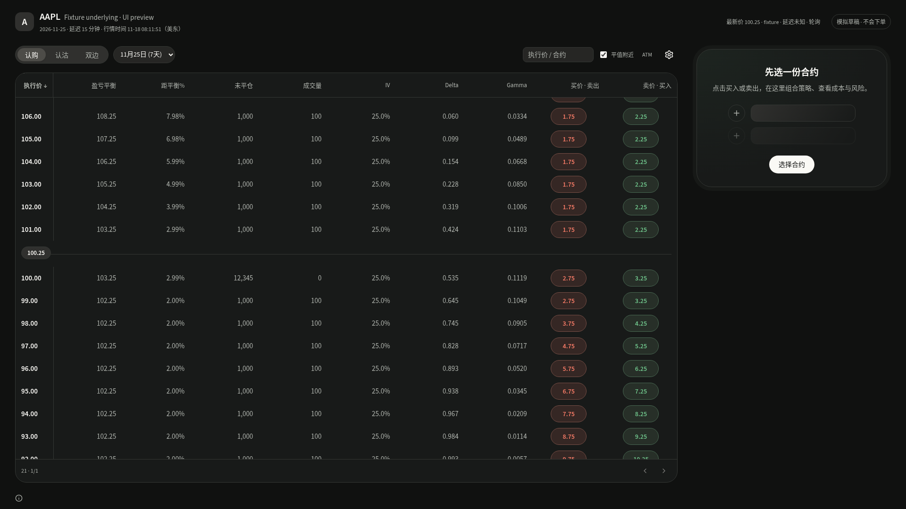
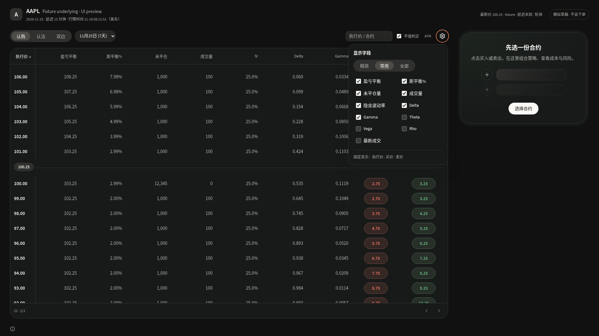
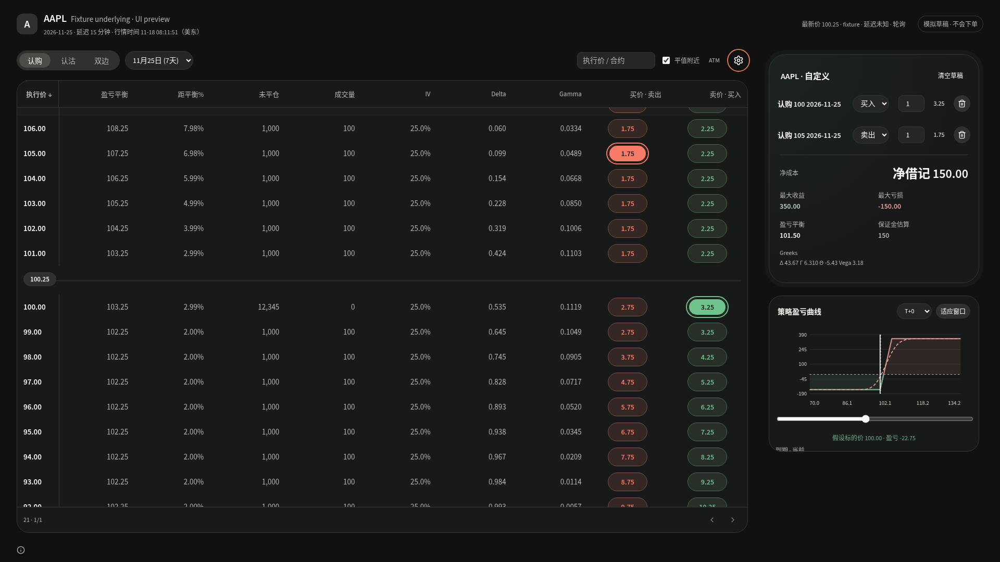
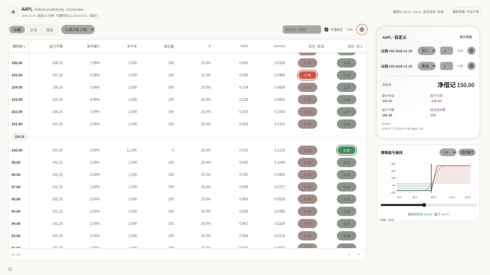

# 期权链与策略盈亏联动工作台

## 改造任务

- [x] 策略页默认打开“联动工作台”，保留“详细分析”中的原有腿编辑、标尺、逐腿解释和收益图。
- [x] 在同一 WebView 中展示期权链、策略腿、收益曲线和风险指标；支持平值附近、认购/认沽、执行价/合约搜索与分页。
- [x] 冻结表头、执行价和添加按钮，控制每页 100 行；最多加载平值附近 2000 个合约，截断时明确提示。
- [x] 买入/卖出追加真实合约，修改数量、方向和移除策略腿后联动计算；这些操作仅修改模拟草稿，不下单。
- [x] 支持盈亏图缩放/平移、适应窗口、假设标的价滑块、鼠标及键盘价格操作，以及 T+0/7/14/30 时点。
- [x] 复用现有 StrategyViewModel/Analytics 定价，展示成本、最大收益/亏损、盈亏平衡、组合 Greeks 和保证金估算。
- [x] 同标的跨到期组合保留首个到期日的模型估值说明；不将未知的最大收益/风险伪装成有限数字。
- [x] 防止过期事件、越界数量、未知合约和不同标的混入；不接受前端传入的合约价格。
- [x] 手工录入价、工作台草稿入场价和读取的已保存入场价不会被后续行情刷新覆盖；IV 可随新行情更新。
- [x] 复用系统 WebView、主题和受限本地通道，隐藏/切换标签时释放浏览器与监听。
- [x] 在实际浏览器中操作真实 C# 后端，并将工作台纳入 Windows x64、macOS Intel/Apple Silicon 三个桌面目标的原生 CI。

## 使用方式

进入“策略 → 联动工作台”，选择标的和到期日。空草稿默认单看认购；已有认沽或混合草稿时跟随选择相应视图，顶部可切换认沽或双边；Web 到期日与原生选择器共用同一个模型。没有策略腿时显示引导卡片，选择报价后出现成本、风险和盈亏图。

- **字段：**齿轮中按需选择 BE、距 BE 百分比、OI、成交量、IV、Delta、Gamma、Theta、Vega、Rho、最新成交；提供精简/常用/全部预设。执行价与 Bid/Sell、Ask/Buy 始终保留。默认常用七个可选字段；偏好写入现有 settings.json，空选择也会保留。快速连续选择即时反映在表格中，保存请求按顺序合并；写入冲突会读取最新有效配置并要求用户重新确认，不静默覆盖其他设置，损坏文件也不会成为可覆盖的新基线。
- **组腿：**买入使用观察到的 Ask，卖出使用 Bid；再次点击同一合约与方向可移除。交叉/缺失报价不能添加。引用价仍不是可成交承诺；手工编辑和旧的中价/最后价入口保留原有语义。
- **ATM：**首次打开，以及切换标的、到期日或链范围时，最接近链快照价格的执行价自动位于滚动可视区中央；手动滚动、行情刷新或换字段不会不断拉回。ATM 按钮清除搜索并重新定位。标的价分隔线位于真实价格对应的执行价之间，不能把搜索结果中的任意一行误标成 ATM。
- **表格：**单侧采用执行价在左的紧凑布局，双侧保留中间冻结执行价；所有列的表头均冻结。宽表只在表格内部横向滚动，窄窗口把分析卡片放在下方；字段弹层始终约束在窗口内。

BE 为单份买入期权按有效 Ask 持有至到期、未计费用的盈亏平衡价，复用 Analytics 的单腿到期分析；百分比是相对链快照标的价的有符号距离。缺少有效 Ask、不存在非负盈亏平衡价或缺少标的价时，对应值为缺失。IV/Greeks 复用 OptionEnricher 与原有定价假设，并保留源值/本地补全依据；OI 和成交量的 0 不会显示成缺失。新字段没有引入前端定价模型或额外行情连接。

盈亏曲线与风险数值来自 C#。图表横轴是标的价格，不把价格伪装为时间戳；采用轻量 SVG 绘制 C# 曲线采样，滚轮缩放、拖动平移，滑块/鼠标/方向键选择假设价格。到期前值遵循现有欧式 BSM、利率、股息及 IV 假设，保证金为估算。复杂组合、股票腿、入场价、IV、逐腿解释等仍可在“详细分析”编辑；两种界面共用同一个草稿和保存功能。

更换标的时不把旧草稿静默混入新合约；若旧草稿仍在，会提示先保存或清空。新报价到达后旧页面的草稿命令会被拒绝，用户应确认最新数据后重试。

## CLI / MCP

未新增 GUI 控制工具。现有 `get_option_chain`、`analyze_strategy`、`save_strategy` 与已保存策略接口覆盖相应业务能力，继续共用 Analytics 和本地存储。

新增的共享 `Meili.Application/OptionEntryReference` 同时服务桌面及 CLI/MCP。`get_option_chain` 保留原 `page` 结构，额外返回同样分页的 `entryReferences`：

```json
{"contractSymbol":"...","reference":{"price":3.0,"basis":"mid","isExecutable":false}}
```

`basis` 为 `mid` / `last` / `missing`。无有效报价时 `price` 是 null，不用理论价格伪造可成交价格。这是兼容性增加字段；操作名称、参数和 JSON schemaVersion 不变。自动化客户端可将明确选择的参考价作为 `analyze_strategy` 的 premium；策略草稿的临时窗口状态不持久化为新的 MCP 资源。能力场景已检查两个传输的返回字段及一致性。

## UI 与资源

使用共享 token 生成的字体、15px 表格、胶囊报价和交易表面配色；支持中英文、深浅主题和窄布局。工作台只加载内嵌 HTML/JS，未增加新的浏览器引擎或第三方脚本库。新闻页面不获得工作台事件权限。

继续使用 256 位随机路径、loopback 监听、Host/Origin/Sec-Fetch 校验、CSP、请求大小/超时/并发限制。事件仅限组腿、数量/方向/删除、清空草稿、假设价格、时点、现有到期日选择和白名单字段偏好；保存仍由用户点击原生保存按钮完成。不暴露文件、任意网络请求或命令执行。

## 验证

- 共享测试验证价差收益与 OptionStrategy 一致、数量更新、缺报价/过期事件保护、私有通道以及锁定入场价。
- Automation 测试验证参考价选择、非有限值及非可执行语义；现有全部能力场景继续逐项跑 CLI/MCP。
- `tests/Meili.Workbench.Host` 是测试专用、离线固定数据宿主，不被生产桌面或 CLI 引用。浏览器测试真实点击并通过生产私有协议到达真实 C# 模型，不在 JavaScript 中模拟定价。
- `tests/webcharts/test_workbench.py` 验证组腿、数量、删除、假设价格、缩放、主题/语言、窄布局及来源/延迟显示，输出 `workbench-dark.png` / `workbench-light.png`。
- 原生 WebView 验收覆盖 Windows x64、macOS Intel/Apple Silicon，包含实际工作台页面、价差收益、数量、假设价格、主题和重启保持草稿。
- 页面集成测试覆盖默认工作台、详细分析切换、共用模型以及隐藏/离开后的资源释放。

本地浏览器回归：

```sh
source tools/env.sh
dotnet build tests/Meili.Workbench.Host/Meili.Workbench.Host.csproj -c Release
python tests/webcharts/test_workbench.py -v
```

需要 Playwright 和 Chromium。原生与完整回归沿用 `tests/Meili.NewsBrowser.Smoke` 和 `bash build/test-headless.sh`。固定数据验收不等同于真实行情联网验证。


## 本次验收：字段、视觉与 ATM 定位

所有新色彩与尺寸经共享 token 生成；数字/卡片层次参考用户提供的 Wealthsimple 图片，不增加经纪商账户、下单按钮或未实现的 AI 功能。报价明细按当前链/到期日/价格缓存，切换显示项或假设价格不会反复补全 Greeks；前端用修订号跳过无关的期权表重建。

CLI/MCP 金融接口与只读边界不变：原始链字段由 get_option_chain 提供，单腿/组合的盈亏平衡由 analyze_strategy 提供。字段选择和视口定位是 GUI 布局偏好，不新增 MCP 控制 UI 的工具。

新增测试覆盖字段持久化/空选择/非法事件、设置冲突与损坏文件、Ask 口径 BE、Greeks 补全、零/缺失、快速勾选、弹层内部点击和键盘焦点、窄屏边界、真实密集链滚动与 ATM 居中。原生 WebView smoke 额外验证列数变化以及重建浏览器后保留字段和草稿。现有 CI 已执行此测试文件及三个桌面目标的 smoke，无需创建重复的工作流。

以下为 1920×1080 真实 Chromium → 私有 HTTP → C# 测试宿主的离线示例，不是真实行情或原生全窗口截图。生产代码没有测试数据开关。









本地已通过 5 项真实 Chromium 交互测试、Shared 152 项、Core 219 项（Linux 跳过 2 项 Windows 专用测试）、Analytics 213 项、Mac UI 150 项、Python 策略 80 项，以及完整离线基线、Windows UI 跨编译。最终代码的跨平台原生 CI 验收待记录；跨编译不等于原生执行。
