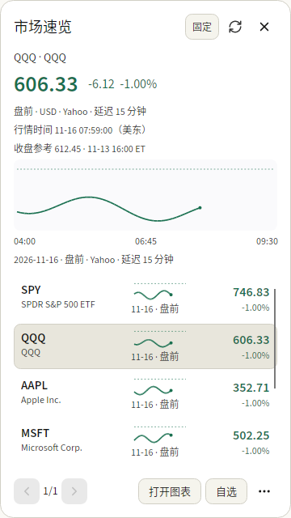
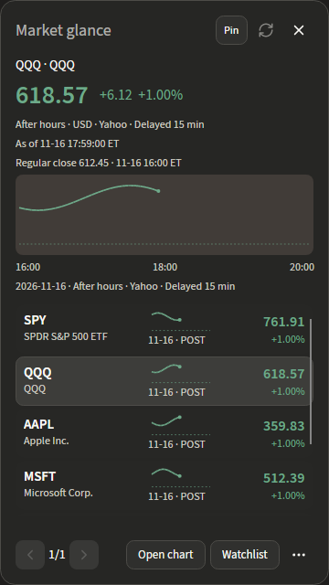

# 盘前盘后行情与紧凑速览

## 展示契约

- Mac 顶部行情、Mac/Windows 速览、Windows 托盘提示复用 `QuotePriceView`，主价选择更新的有效盘前/盘后报价，显示原始行情时间与时段。常规收盘作为独立参考，业务服务及 CLI/MCP 原始报价不改写。
- 仅接受正有限价格、已知且不在未来的时间、新于常规报价，且来源不为常规交易中的扩展报价。未知时间或无效扩展价不能替换主价。
- 扩展涨跌优先采用来源数值；缺失时相对常规收盘计算。不开盘后改用昨收冒充盘前/后涨跌。缺失基准保留未知。
- 时段依据报价的实际美东时间；周末旧盘后报价在周一盘前仍标盘后并显示陈旧状态。主价来源声明、抓取时间与图表来源分别保留。
- 走势图匹配报价日期及盘前/常规/盘后时段，不拿上一交易日常规走势填充。时间轴分别为 04:00/06:45/09:30、09:30/12:45/16:00、16:00/18:00/20:00 ET。未知扩展时段不猜测轴线。
- 扩展时段采用共享浅色底；扩展主价时隐藏常规 OHLCV，避免误读为盘前/后成交数据。图表缺失明确为空，不造走势。

## 摘要布局和打开位置

Mac 360×640 DIP，Windows 420×680 DIP；价格/涨幅在行右侧上下排列，迷你图、日期/时段保留。长公司名省略，详情通过 tooltip 提供。列表滚动与分页保留，不为缩窄而删除标的。

Mac 读取状态栏窗口实际 NSScreen 与 display ID，取本屏顶部坐标，以目标屏比例映射到 Avalonia 屏幕像素。窗口中心与行情项中心对齐，距底部 4 DIP；靠近屏幕两侧时仅做边界避让。每次重开重新锚定。覆盖负坐标副屏、1×/2×缩放、左右边缘的定位回归用例。原生 smoke 增加真实 NSStatusItem 屏幕匹配、坐标范围和点击 target/action 检查，由两种 Mac 架构 CI 执行。

## 测试和证据

- 全量离线回归：825 项 .NET、54 项 Python，以及全部 47 项真实 CLI/MCP 进程能力对照通过。包含 Mac 121 项、Shared 94 项；面板/菜单/定位 15 项亦单独通过。记录目录：`build/out/tests/run-O8L9f7GV`。
- Windows WPF 完整测试项目交叉编译成功；此环境不能执行 WPF 或 AppKit。Mac 原生 smoke 项目编译成功，新增原生屏幕锚定检查尚需本次提交的 GitHub Actions 执行，不能把 headless 通过视为原生通过。
- CI 复用 `.github/workflows/ci.yml`：Linux headless 包含新增测试，两种 Mac 架构原生 smoke 包含新增锚点检查，Windows 原生完整 WPF 测试包含扩展行情窗口用例。无新增业务操作，无需新增 CLI/MCP schema。
- 性能边界不变：复用 QuoteHub/QuotePump、最多两个图表请求并发、隐藏取消及释放订阅、无新行情定时器，仅缓存三个时段的绘图投影。

### 真实行情验证

通过生产 Application 服务抓取 QQQ 报价和 5 分钟 K 线，再调用生产 `QuotePriceView.Select` 和 `IntradaySparkline.Create`，使用独立临时数据目录及显式 `MEILI_LIVE=1`。

2026-11-16 北京 18:32:26 抓取：Yahoo 常规收盘 **679.89**（11-13 美东 16:00），盘前主价 **673.67**（11-16 美东 05:31:56），涨幅 **-0.9148585%**。对应 11-16 盘前图有 19 个有效点，时间轴 04:00–09:30。此为抓取时快照，不是后续即时价格。[机器报告](extended-sessions/live-qqq.json)

### 截图

以下是离线 fixture 的真实 Avalonia 控件渲染，数字不是实时行情。自然尺寸为 360×640；1920×1080 图把同一真实面板控件放在真实主窗口控件上展示相对尺寸，属于 headless 应用测试场景，不是 macOS 桌面或原生锚点验收截图。

[盘前 1080p 场景](extended-sessions/premarket-1080p.png) · [盘后 1080p 场景](extended-sessions/postmarket-1080p.png)
