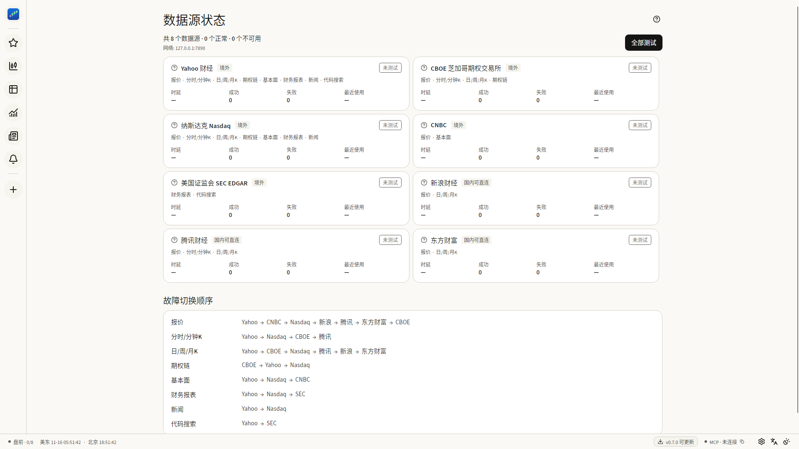
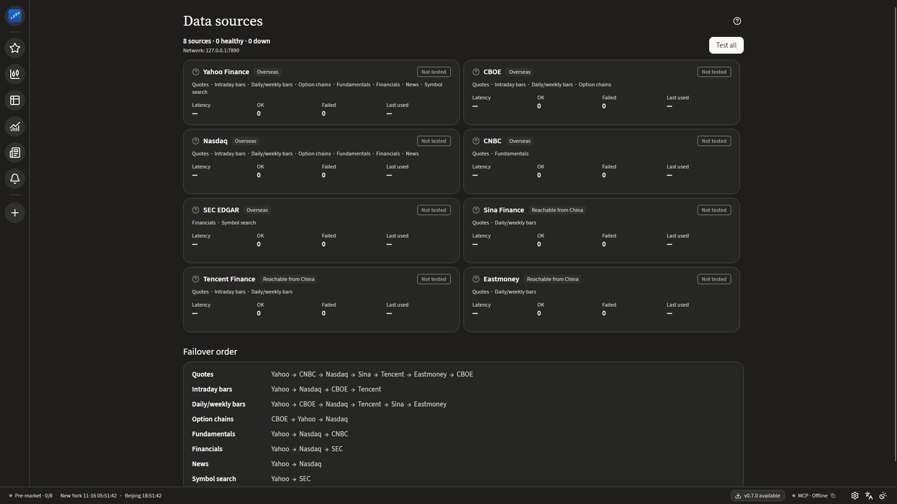

# 数据源状态与自动检测

## 使用

macOS / Windows 删除左侧数据源图标，只保留底部合并的市场/数据源状态入口。点击或键盘激活直接进入原有数据源页面；悬停仍可查看市场时段、来源汇总和网络路径。保留原有页面路由、快捷键及「全部测试」。

原问题是页面仅在所有来源均为 Unknown 时自动测试；启动后 Yahoo 的正常行情调用已让一个来源被测试，导致整轮检查被跳过。

## 调度与真实性

`DataSourceHealthMonitor` 是桌面唯一探测协调器。启动代理检测完成后进行一轮检测；代理检测失败也使用当前配置启动探测，不留下永久未测试状态。前台完成一轮后每五分钟复测，30 秒低优先级调度检查不做网络调用。网络配置改变时失效并取消旧轮次，重新检查。

- 复用现有 `FailoverRouter.ProbeAsync`，真实结果写入同一个 HealthTracker，底部状态和页面读取同一份数据。
- 手动与自动请求合并；一次最多两来源并发，每来源 12 秒，整轮 60 秒上限。单来源超时记真实失败，不阻塞其他来源。
- 全部桌面展示隐藏时停调度并取消未完成检测；恢复后补测过期/中断轮次，新鲜结果不重复探测。退出取消并退订事件。
- 检测期间底部显示紧凑省略号，tooltip 显示「测试中」；页面按钮同步检测状态。未知、失败和不稳定状态保持真实，不能承诺或伪造 8/8。
- 这是来源的代表性接口检测，不证明该来源所有能力、所有标的或实时行情都可用。不新增行情轮询、提醒循环、MCP 工具或生产测试数据开关。

CLI/MCP 仍使用现有 `get_source_health` / `probe_data_sources`，桌面自动周期、入口位置属于展示生命周期。已更新 desktop_capabilities.json 的 Shell 命令例外。

## 验收

`bash build/test-headless.sh` 全量离线回归：828 项 .NET、54 项 Python、全部 47 项真实 CLI/MCP 进程对照通过。记录：`build/out/tests/run-DpqUfQdS`。启动异常回退调整后另行重跑 Shared 97 项并通过，Windows 完整测试项目重新编译通过。

- Shared 97 项通过；新增三项调度回归覆盖启动已有一源可用时仍检查全部来源、五分钟节流、后台停调度、过期恢复、并发上限、手动去重、取消/退出、网络失效重测及错误不热重试。
- Mac 专项五项通过：中英明暗、1920×1080 / 980 宽度、底部点击进入真实数据源页面、侧栏无数据源入口、文字和图标垂直对齐、原有网页标签保留。
- Windows WPF 全测试项目交叉编译通过；相同的底部点击/侧栏/对齐行为已加入原生 WPF 测试，本地 Linux 不能替代 Windows 原生执行。
- CI 现有 Linux headless 自动发现新增 Shared 用例；Windows 两架构执行完整 WPF 套件；Mac 两架构构建/原生集成保持。没有放宽过滤器或删除目标。

截图是 1920×1080 真实 Avalonia 控件的离线 headless 渲染；来源未知状态表示测试宿主未联网，不代表实际连通性测试结果。

