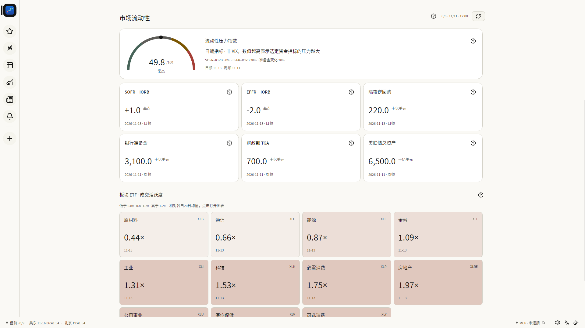
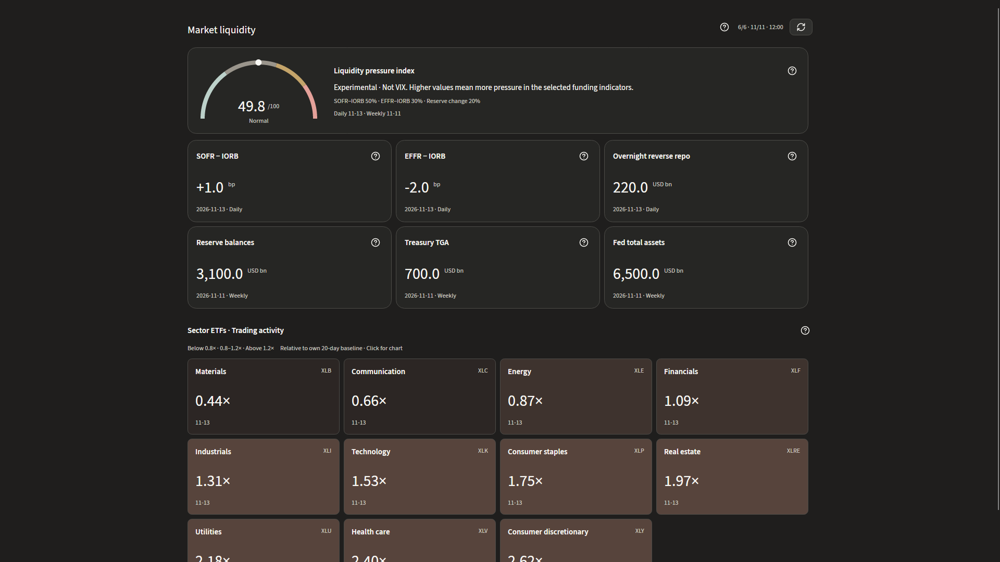

# 市场流动性与行业热力图

## 入口与交互

概览页的行情卡片下增加市场流动性模块；没有再新增侧栏或改变原有快捷键。宏观六卡保留指标、数值、单位、观察日期/频率；解释与来源放在 `AppHelp`，刷新/加载使用原有按钮和 `AppLoading`。行业热力图点击打开对应 ETF 图表，保留键盘访问。

布局复用 `LiquidityPanel`（两个平台的业务组合）、`AppCard`、共享文字/按钮样式。新增可复用 `AppActionCard` / `AppGauge`，其中操作卡片，只扩展“整卡操作、内容可伸展”的语义，继承既有按钮模板、焦点、禁用及减少动态约定，不复制模板。宏观/价格不做数值动画。已补组件画廊及实际点击测试。热色引用主题 Series2 和 tokens.json 的三个透明度，独立于涨跌配色，避免把高成交活跃度解释成上涨或“更好”。

## 流动性压力指数（自编参考）

顶部增加类似压力/恐慌指标的 0–100 半圆表盘，但明确标为 **Experimental / 非 VIX**。它是可审计的启发式资金压力指标，不是官方指数、股市波动率或校准过的预测模型。

固定方法 `funding-pressure-v1`：

- `S = clamp(50 + 2 × SOFR-IORB基点, 0, 100)`，权重 50%。
- `E = clamp(50 + 2 × EFFR-IORB基点, 0, 100)`，权重 30%。
- `R = clamp(50 − 500 × (本期准备金 / 前四个周观察值准备金 − 1), 0, 100)`，权重 20%。
- `Score = round(0.5S + 0.3E + 0.2R, 1)`。利差±25 bp对应子分数0/100；准备金下降10%对应其子分数100。这些是公开的方法参数，不声称经历史回测校准。

区间标签：`<30`偏松、`30–<60`常态、`60–<80`偏紧、`≥80`高压，仅表达本方法的相对标签。RRP/TGA/Fed资产作为背景卡片保留，不强行把余额高低解释为单调压力方向。

必须同时有两项利差、至少5个准备金周观察值和正的准备金基准；日频输入超过7个自然日、周频输入超过21日或输入在未来时不给分数，保留 null/原因，不填50或重新加权。各分项的实际日期、原始输入、比较日期、子分数和权重保留；不同频率不伪装为同一时刻的实时快照。

MCP 同一只读报告新增 `pressureIndex`：`score/band/method/formula/components/unavailableReason/interpretation`。CLI、桌面和 MCP 调用同一个 Application/Analytics 实现。companion skill 明确说明实验性、日期、口径和不能据此推断收益/恐慌概率。

可复用 `AppGauge` 的原生渲染器共享 `GaugePlan`，色彩来自已有主题语义色，几何/粗细来自 tokens；无数值/指针补间动画，不引入浏览器或额外定时器。缺失/非有限分数不绘制标记。画廊、三端数值一致性、左右端点/中点、空值、陈旧/未来/历史不足均已覆盖。

## 六项宏观指标

| 指标 | FRED 原始序列 | 运算/显示单位 | 观察口径 |
| --- | --- | --- | --- |
| SOFR − IORB | SOFR、IORB | `(SOFR% − IORB%) × 100`，基点 | 日频，仅相同观察日期 |
| EFFR − IORB | EFFR、IORB | `(EFFR% − IORB%) × 100`，基点 | 日频，仅相同观察日期 |
| 隔夜逆回购 | RRPONTSYD | 原值，十亿美元 | 日频，操作余额；非全市场回购成交量 |
| 银行准备金 | WRESBAL | 百万美元 ÷ 1000，十亿美元 | 周平均值 |
| 财政部 TGA | WTREGEN | 百万美元 ÷ 1000，十亿美元 | 周平均值；不是实时财政部余额 |
| 美联储总资产 | WALCL | 百万美元 ÷ 1000，十亿美元 | 周三时点值 |

官方来源：[SOFR](https://fred.stlouisfed.org/series/SOFR)、[IORB](https://fred.stlouisfed.org/series/IORB)、[EFFR](https://fred.stlouisfed.org/series/EFFR)、[RRPONTSYD](https://fred.stlouisfed.org/series/RRPONTSYD)、[WRESBAL](https://fred.stlouisfed.org/series/WRESBAL)、[WTREGEN](https://fred.stlouisfed.org/series/WTREGEN)、[WALCL](https://fred.stlouisfed.org/series/WALCL)。FRED 聚合来自纽约联储/美联储的原始发布，公开 CSV 无需 API key。

不跨日期拼接利差，不前向填充缺失日。`DateOnly` 保留观察日期，`FetchedAt` 单独记录抓取时刻；不把下载时间伪装为指标生效时间。余额、周均值和时点值并不代表同步实时流动性，也不输出未经验证的综合风险分数或股市“可用资金”。每个原始输入保留 ID、单位、频率、来源链接、观察值及 observationBasis。

## 行业热力图的准确含义

覆盖美国 11 个 SPDR 行业 ETF：XLB、XLC、XLE、XLF、XLI、XLK、XLP、XLRE、XLU、XLV、XLY。ETF 是板块代理，不能据此声称覆盖每只成分股、全行业实时订单簿或资金净流入。

- 主热度 = 最近一个已完成日的 `close × volume` / **此前** 20 个观察值的均值，最新一日不进入自身基准。1×是各 ETF 自身的成交活跃度常态，不是跨行业绝对流动性排名。
- 当前美东日期的日线始终排除，避免未完成日与历史整日比较。默认因此有明确的一日滞后；每格显示实际日期。历史取近 120 个自然日，至少需要 21 个已完成的正价格/正成交量日线观察值。
- 估算成交额为收盘价×成交量，不是 VWAP 精确成交额，也不是净流入。请求 split 调整并保留来源实际 adjustment；调整未知时不伪称原始价格。
- Amihud 代理 = 近 20 个观察值 `abs(close/previousClose − 1) × 100 / (close × volume) × 1,000,000` 的均值，单位 **% / USD million**。数值越大表示估计价格冲击越大；不是买卖价差或可执行深度。UI tooltip 和 MCP 返回原值与定义。
- 颜色分档 `<0.8×`、`0.8–<1.2×`、`≥1.2×`；无数据为中性，不补零、不捏造排名。缺失、非有限值或无效最近窗口使该格不可用；offline 标记、来源、时间和基准观察数保留。

## 工程与性能

- Core：日期型序列、六项指标和行业代理的传输模型，ILiquiditySeriesSource；不依赖 UI。
- Data：FredLiquidityProvider 的固定七序列白名单、HTTP/CSV、单位/频率/口径、180 天观察窗口；共享 HttpGateway/代理/限流及现有 ResponseCache，TTL 30 分钟，已在统一缓存入口管理。
- Analytics：无 I/O 的精确日期利差与成交额/Amihud 运算；不依赖 Core 或 UI。
- Application：MarketLiquidityService 组装同一份报告；两个并发，每项 6 秒等待预算，整轮 58 秒。来源部分失败仍返回其它可用项目，取消保留为取消。每个缺失项带原因并记录诊断。
- Shared：LiquidityViewModel 管理激活/刷新、30 分钟报告复用、隐藏取消和世代防迟到；页面无新行情定时器。取消本页面等待与后续工作，不中断其它调用者共享的有限缓存请求。
- 数据源页新增 FRED（当前共 9 个来源）。`IConnectivityProbe` 让 FRED 代表性连通性检查绕过 30 分钟数据缓存；断网不会因缓存而被判为连接正常。沿用统一自动检测，按当前来源数给足整轮预算。

## CLI、MCP 与 companion skill

```sh
easysellput liquidity --json
easysellput get_market_liquidity --json
```

MCP 调用只读 `get_market_liquidity`，参数 `{}`；不需要 `--allow-writes`。返回 `pressureIndex`、六项 `metrics`（含完整输入与单位）、11 项 `sectors`、缺失/offline/adjustment、基准天数和 `heatmapBasis`。`get_source_health` / `probe_data_sources` 也能检查 FRED；不新增任意 URL、窗口控制或后台提醒工具。

操作目录、CLI alias/help、desktop inventory、真实进程 capability case 均已补齐。companion skill 升为 2.1，增加选择工具、宏观/行业口径、缺失/日期约束和 chart 后续研究指导。精确已发布 2.0 内容可备份升级，自定义 skill 继续保护。

## 验收与 CI

离线 .NET：Core 199、Data 138、Analytics 209、Shared 102、Mac 123、Automation 74，共 **845 项通过**；54 项 Python guards、全部 48 项真实 CLI/MCP 进程对照通过。全量记录 `build/out/tests/run-L7igc2Yr`。新增主窗口/表盘绑定与实际点击截图后另行重跑 LiquidityPanel 两项通过。Windows 全测试项目交叉编译通过；原生执行由 CI 验证。

另修复上一版 Windows 安装包 smoke 的过期假设：数据源已移到底部，但自检仍寻找被删除的侧栏 tile。现改为通过真实 WPF Automation Invoke 激活底部按钮，验证目标页面、零侧栏选中及无重复入口；保留其它页面的完整导航/图标检查，没有跳过该页面。对应 WPF 测试同步改用 Automation Invoke。

专项覆盖：CSV 空值/非法 HTML/非有限值/未来日、缓存共享/清理、缓存不能冒充连通性；日期精确交集、基点与单位换算、基准排除当日/最近无效数据/历史不足、取消与迟到世代、部分失败、无缺失热图、实际点击图表跳转、中英明暗、1080p/紧凑布局、组件画廊及按钮族对齐。

现有 CI 自动发现这些用例：Linux headless 全量、五种 CLI/MCP 目标的真实 48 操作对照、四种原生桌面构建/包验证、Windows 完整 WPF 测试。未删除架构或放宽过滤器。Linux 交叉编译 WPF 不是 Windows 原生执行，原生结果以本次提交 CI 为准。

### 真实行情验证

显式 `MEILI_LIVE=1`，生产 CLI、独立临时数据目录、公开官方源和真实 ETF 日线，成功取得 6/6 + 11/11。[原始 JSON 快照](liquidity/live-snapshot.json)。抓取时间：2026-11-16 北京 **19:11:57**。

- SOFR−IORB 0 bp、EFFR−IORB −2 bp，共同观察日 2026-11-12。
- ON RRP 0.325 USD bn，观察日 2026-11-13。
- 准备金 2960.603、TGA 914.37、Fed assets 6758.867 USD bn，观察日 2026-11-11；前两项周均、后一项周三时点。
- 全部 11 个 ETF 的最新已完成日为 2026-11-13，由 Yahoo 日线计算，各自使用 20 个先前观察值。

这是抓取时快照，非实时保证；截图中的 fixture 数字与这份真实来源快照分开。

### 指数真实验证

随后使用同样的生产 CLI 和独立数据目录验证指数：[完整快照](liquidity/live-index-snapshot.json)。2026-11-16 北京 **19:37:22**，得分 **50.8/100，常态**。

SOFR−IORB 0 bp → 子分数50，EFFR−IORB −2 bp → 子分数46；准备金从10-14到11-11减少约2.0362% → 子分数60.1810。加权50/30/20后为50.8。原始输入及日期在快照中可重算；这不是实时数值保证或官方恐慌指数。

### UI 截图

下图为真实 Avalonia 控件的 1920×1080 离线 headless 渲染，数据为测试 fixture，不是原生操作系统或实时行情截图。整合图是实际主窗口/概览页滚动到新增模块。





[中文浅色完整组件](liquidity/mac-liquidity-1080p-zh-CN-False.png) · [980 宽紧凑状态](liquidity/mac-liquidity-compact-zh-CN-False.png)

[行业热力图完整视口](liquidity/mac-liquidity-heatmap-1080p-zh-CN-False.png)
