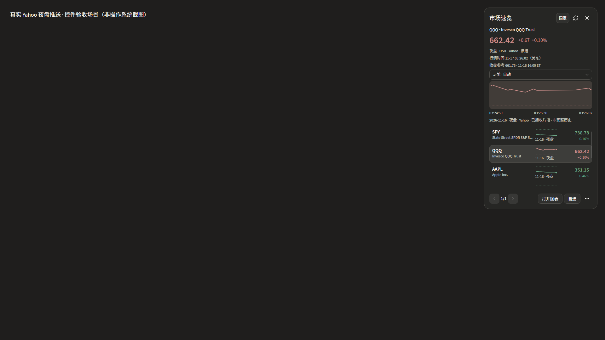

# 速览全部时段与夜盘推送

## 行为

- macOS 速览与 Windows 托盘摘要使用同一模型、原生 AppSelect：自动、盘前、常规、盘后、夜盘。选择同步作用于大图和全部迷你图；上方价格继续表示最新报价，不伪装成所选历史时段的价格。
- 盘前/常规/盘后保留固定美东轴。夜盘按 20:00–次日 04:00 分组，午夜后归入前一晚的会话日期；这不是新增交易日历或 24 小时交易承诺。
- 正常盘前/盘后推送通过 LiveBarStitcher 更新未完成尾部；发现历史缺口后复用现有单飞刷新，最多每 15 秒修补，不新增行情计时器。
- Yahoo 夜盘原始 PricingData 的 `market_hours=4` 之前被识别为 Unknown，现明确解码为 Overnight，进入同一 QuoteHub/QuotePump。已记录的真实帧作为离线协议测试，未知其他代码继续保持 Unknown。
- 夜盘 HTTP 历史可能为空，但推送仍存在。夜盘使用实际收到的价格路径；仅有一个价格时画点，后续价格形成片段。收到的片段按其真实时间范围缩放并标注“非完整历史”，不把几秒钟走势拉成整个夜盘，也不接回盘后曲线冒充夜盘。
- 主图将不连续的夜盘片段作为独立线段，避免价格线跨越未提供的历史。过度碎片化时保留全部观察点，限制原生 series 数量，避免无限叠加。
- 原始常规报价/收盘参考、来源时点、HTTP 元信息与夜盘价格继续独立。尚未取到常规参考时允许显示真实夜盘价，常规价保持未知；不把夜盘价写成常规收盘，不改写期权链同期 Spot、IV、Greeks、GEX 或入场假设。
- 图形涨跌颜色根据其自身参考，最新价的颜色继续使用最新报价参考。缺数据与请求失败分开显示；下拉打开不触发自动隐藏，Esc 先关闭下拉，再关闭摘要。

## 后台与缓存

`OvernightObservationBuffer` 归入既有 QuoteHub 的 `quotes` 托管内存缓存，不创建第二条 socket 或计时器。最多 50 标的，每标的 1024 点、10 小时；近期保留真实秒级价格，较早数据压缩为实际分钟观察点，不插值、不编造 OHLC/成交量、不写入历史 K 线库。

摘要隐藏后停止绘图、图表请求和自身订阅。若菜单栏等现有消费者仍订阅该标的，后台收到的夜盘点会保留，重新打开即恢复；没有任何消费者就断开。首次启动、未订阅、断线和源未提供期间的历史不能凭空恢复。清理 quotes 缓存会移除缓存观察点，同时保留现有显示与订阅；进程内图形快照不是磁盘归档，重启不承诺恢复完整夜盘。

## CLI / MCP

复用 `live` / `get_live_quotes` 与 `live-bars` / `get_live_bars`。[生产 CLI 夜盘衔接结果](overnight-glance/production-live-bars.json)保留独立的历史来源与 Yahoo 夜盘观察来源。增加的 session 为 `Overnight`，夜盘不完整观察的状态为 `observed_partial`，返回原始时间、真实价格、未知 OHLC/量及缺失范围。样本仍只读、有界，取消即停止，不创建持久监控。伴随 skill 2.4 解释这些语义，已知官方旧版可备份升级，自定义内容继续受保护。

## 实际源验证

北京时间 2026-11-17 的生产接口验证：QQQ 5 分钟历史返回 192 个实际周期点（04:00–19:55 ET），不含夜盘；直接尝试 includeOvernight=true 的历史响应同样没有夜盘。与此同时，真实 WebSocket 返回 QQQ、SPY 的夜盘报价，原始字段 7 为 4。

原生控件使用真实 DataServices / YahooQuoteStream / QuoteHub 验收，未使用 fixture 行情。报告和截图保留源时间、接收区间、接收数、图形点数与覆盖限制：[机器报告](overnight-glance/live-overnight.json)。这证明该观察窗口中数据到达并进入图形，不证明全市场覆盖、完整逐笔或零延迟。

## 验收与 CI

覆盖真实帧解码、收盘参考尚未到达、HTTP 晚到不回滚、夜盘观察去重/容量/过期/清理、隐藏期间接收并恢复、午夜分组、缺失时段不替代、单点显示、当前时段同步、弹出选择及 Esc、主图历史缺口不连线。既有完整 Core/Data/Shared/Application 测试和 Mac/WPF 原生 UI 测试由 GitHub Actions 全平台执行；Live UI 用例只在明确 MEILI_LIVE=1 且实际夜盘时段执行，离线 CI 不访问行情源。

截图区分真实行情与离线 fixture，headless 控件渲染不等于 AppKit/WPF 原生窗口执行或真实操作系统桌面锚点验收。

## 截图

下图为真实 Yahoo 夜盘数据在实际 Avalonia 控件中的 headless 渲染，1920×1080 验收场景，不是 macOS 操作系统截图。此次约 80 秒接收到 13 条 QQQ 夜盘更新，保留 11 个有序源时间点；收盘参考 661.75 与夜盘 662.42 分开。数字是北京时间 2026-11-17 16:26 的验证快照，不代表当前价格。

[原尺寸真实摘要](overnight-glance/real-night-compact.png)

[生产只读 MCP 夜盘验证](overnight-glance/production-mcp.json)通过真实 stdio 协议调用 get_live_quotes，返回 Overnight 源时间和价格。完整本地离线六项目共 954 项 .NET 测试通过；58 项真实 CLI/MCP 场景、55 项 Python 守卫和 8 项浏览器 renderer 回归通过。Windows 完整测试项目交叉编译成功；原生跨平台执行仍以本次 GitHub Actions 结果为准。
