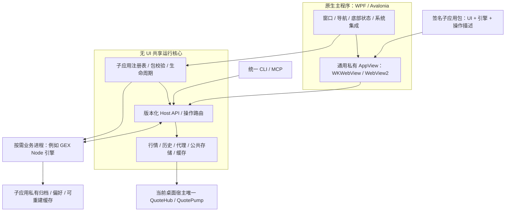

# 主程序与可独立更新子应用：架构研究与迁移提案

状态：**提案，尚未实现或发布**。研究日期：2026-11-17（北京时间）。

实施已获授权；执行步骤与逐步提交/验收记录见仓库 [TODO.md](../TODO.md)。以下研究基线和实测结果保留其当时版本，不代表最新工作分支状态。

后续研究：[56 · CLI/MCP 优先的子应用运行架构](56-CLI与MCP优先的子应用运行架构.md)。该文补充了实际进程与 SDK 验证，并修订本提案的宿主中心、包组件和 MCP 升级模型：无 UI 的运行核心服务三个入口，不将长寿命 MCP 进程等同于协议会话或永久包租约。协议同时考虑已验证的 2025 兼容模式与当前 2026-07-28 无状态模式。

代码基线：远端 `two4i6/EasySellPut` 的 `work@b863eaa787a3467784f6a10569187738b231a879`。本轮已执行 `git fetch origin work` 和 `git merge --ff-only FETCH_HEAD`；本地与远端一致，开始研究时工作区干净。

## 1. 建议采用的方案

采用 **原生主程序 + 签名的本地子应用包 + 按需运行的业务进程**，先在同一仓库内实施。QQQ GEX 是首个试点；不立即重写所有原生页面。

“主程序”应分成无 UI 的运行核心和桌面外壳：核心拥有公共数据、权限、包与操作路由，桌面拥有窗口、导航和系统集成；CLI/MCP 直接复用核心，不通过桌面转发。子应用包拥有自己的 UI、领域逻辑、操作描述与私有数据格式。子应用更新时只替换该包；正常情况下无需下载、退出或重新发布主程序。

这里的“独立”默认指：在主程序工作区内运行，但可以独立开发、构建、安装、更新、停用和卸载。**不要求每一个子应用都变成单独的 macOS `.app` 或 Windows 安装程序。** 后者会重复窗口、运行时、设置、行情连接和更新器，也破坏目前的一体化体验。开发阶段提供轻量开发宿主即可。

可独立更新有明确范围：子应用只能使用已安装主程序提供的宿主 API、运行时和能力。如果新增能力、修改宿主协议主版本、升级系统 WebView 所需条件或引入新的原生依赖，仍需更新主程序。不能承诺旧主程序永远运行未来的所有子应用。

优先级：

1. 固定宿主 API 和包生命周期，让现有 GEX 从磁盘上的签名包运行。
2. 让 GEX 的业务引擎、数据访问、CLI/MCP 描述也随包更新，真正解除主程序发布依赖。
3. 稳定后按业务边界迁移其他应用；保留合适的原生界面与基础能力。

## 2. 当前代码到底耦合在哪里

### 2.1 已经存在的可复用基础

| 能力 | 现有实现 | 对拆分的价值 |
| --- | --- | --- |
| 分层业务与传输 | Core / Analytics / Data / Application / Shared / 两个桌面端 / CLI | 已有清楚的 UI、业务、数据边界，不需推翻分层 |
| 跨平台私有 Web 页面 | `QqqGexSession` + WKWebView / WebView2 | 已有本地资源、来源校验、CSP、有限并发与可见性生命周期 |
| GEX 独立计算 | `QqqGexCalculationRunner` 启动固定 Node 下的原算法 bundle | 可从“嵌入主程序的业务进程”逐步变为“子应用业务进程” |
| 行情与时段衔接 | QuoteHub / QuotePump / QuoteStreamingService / LiveBarStitcher | 子应用只订阅宿主，保留盘前、盘后、夜盘、来源与缺口语义 |
| 公共设计资源 | `tokens.json`、生成器、原生 primitives、CSS、Lucide、字体来源记录 | 可以导出版本化 Web UI 包与宿主外观上下文 |
| 原子持久化 | SnapshotFile / SQLite 事务与 generation | 可用于注册表、会话租约、升级状态与缓存失效 |
| 发行信任 | UpdateClient / UpdateInstaller / main-only Actions | 可复用校验原则与基础工具；不是直接套用主程序整包安装事务 |
| 业务自动化 | OperationCatalog + AutomationService + CLI/MCP 测试 | 可演进为宿主操作目录与已安装子应用操作目录的组合 |

### 2.2 GEX 目前还不是独立子应用

| 代码位置 | 当前事实 | 独立更新的障碍 |
| --- | --- | --- |
| [Application 项目](../src/Meili.Application/Meili.Application.csproj) | 构建时执行 `npm run build:runtime`，嵌入 `import.mjs`、`query.mjs`、`history.mjs` 和 Node lock | 改算法仍须重编译 Application，CLI/MCP 也受影响 |
| [Shared 项目](../src/Meili.Shared/Meili.Shared.csproj) | 构建 Web assets 并作为 `QqqGex/*` 嵌入程序集 | 改 GEX 页面仍须重打桌面整包 |
| [QqqGexSession](../src/Meili.Shared/Services/QqqGexSession.cs) | 同时负责 HTTP、页面资源、行情、偏好、数据库读取和领域路由 | 宿主传输和 GEX 领域知识混在一个类型里 |
| [QqqGexCalculationRunner](../src/Meili.Application/QqqGexCalculationRunner.cs) | 固定脚本资源名、查询 URL、数据库路径；每次任务启动进程 | 子应用增加查询或替换实现仍要改宿主 |
| [QqqGexCaptureService](../src/Meili.Application/QqqGexCaptureService.cs) | 负责到期日、完整性、原始数据保留、分钟聚合和上下文采集 | 部分 GEX 领域规则还在 C# 主程序中 |
| [GEX 数据层](../src/Meili.Data/Cache/QqqGexResponseStore.cs) | 原始记录、归档、响应缓存与多个查询投影跨 C#/TS 访问 | 只替换 TS 文件可能与旧 C# 表结构和投影不兼容 |
| [操作目录](../src/Meili.Application/OperationCatalog.Coverage.cs) / [自动化执行](../src/Meili.Application/AutomationService.Coverage.cs) | GEX schemas、参数范围、分派与部分查询编译进主程序 | 页面独立后，MCP 仍不能独立演进 |
| [Avalonia 导航](../src/Meili.Mac/MainWindow.axaml.cs) / [WPF 导航](../src/Meili.App/MainWindow.xaml.cs) | 固定 AppPage、类型映射和创建逻辑 | 新增/卸载子应用不能自然改变导航 |
| [SharedComposition](../src/Meili.Shared/Services/SharedComposition.cs) | 缓存服务直接注册 GEX store | 卸载 GEX 后，宿主仍知道 GEX 的数据库和实现 |
| [CI](../.github/workflows/ci.yml) / [发行](../.github/workflows/update-release.yml) | GEX 有 Web 检查，但仍嵌入各平台整包和 CLI 包 | 单独 Web job 不等于独立发行管线 |

本次 `git ls-files web/qqq-gex` 得到 429 个受跟踪文件，约 4.39 MB 源文件。这个数字包含迁移资料、原始源码等，**不是安装体积或可节省的下载量**。需要以真实压缩包与安装目录另测。

现有源码目录有些历史说明已经被后续 checkpoint 覆盖，实施前以最新代码与 [GEX 验证记录](../web/qqq-gex/VALIDATION.md) 的最新章节为准，不能把 README 中某个旧阶段直接当成最终验收。

## 3. 方案比较

| 方案 | 独立 UI 更新 | 独立业务更新 | 主要代价 | 建议 |
| --- | --- | --- | --- | --- |
| 继续按页面拆 `.csproj`，静态引用 | 否，仍打整包 | 否 | 改动少，但不解决发布瓶颈 | 作为代码整理手段，不能作为目标架构 |
| 进程内动态加载 WPF/Avalonia DLL | 可以，但与 UI 框架紧耦合 | 可以 | 两套原生 UI、依赖版本冲突、事件/静态引用导致卸载困难，崩溃影响主进程 | 不作为默认子应用格式 |
| 远端网站 / iframe / 浏览器标签 | 服务器发布后立即变化 | 取决于远端 | 离线、隐私、来源信任、版本回退、实时行情共享更难保证 | 保留个人网页功能，不作为官方本地应用机制 |
| 每个页面一个完整桌面 App | 是 | 是 | 重复运行时、窗口、配置、行情、安装与签名维护 | 暂不采用 |
| 本地 Web 包 + 宿主 API + 可选业务进程 | 是 | 是，在兼容宿主能力内 | 首次需要包管理、协议和迁移；WebView 资源占用需治理 | **推荐** |

.NET 官方插件文档明确说明：不可信代码不能安全地载入可信 .NET 进程。`AssemblyLoadContext` 的卸载也是协作式，调用 Unload 不保证立即释放。它可以用于受控插件，但不自动解决 UI 引用、进程稳定性或安全隔离。

可借鉴 VS Code 的“宿主 API + 扩展运行环境 + 私有 WebView”边界，但不引入 Electron、不照搬完整扩展市场，也不在首期建设通用分布式平台。

## 4. 推荐的运行架构



图中的 Host API 是同一份 Application 层实现，不表示 CLI 必须连接已运行的 GUI。CLI/MCP 没有桌面时仍应正常工作。桌面拥有持续行情和提醒监控；CLI/MCP 保留已有有界采样，不能新建一个持续后台监控副本。

### 4.1 主程序拥有的内容

- 原生窗口、系统栏、快捷键、菜单栏/托盘、关闭到后台、退出、原生通知与浏览器容器。
- 导航和应用管理 UI：安装、更新、停用、卸载、顺序及恢复入口。
- 统一行情、历史行情、数据源、网络代理、限流、时间语义与公共缓存。
- 公共用户记录：自选、策略草稿/已保存策略、提醒和图表画线，通过既有 Application 服务读写。
- 权限判断、请求界限、取消、数据目录选择、统一 CLI/MCP 协议与操作注册。
- 发行根信任、下载校验、包注册事务、运行时管理，以及可见性/后台资源预算。
- UI tokens、外观/语言/动效上下文、宿主交互协议及跨应用导航。

### 4.2 子应用拥有的内容

- 业务页面、业务特有交互与展示状态。
- 已有领域算法的单一实现；GEX 保留原始 TS 引擎、版本/来源记录与等价性测试。
- 私有数据结构、领域归档、投影、业务缓存及自身迁移方案。
- 业务操作 schema、结果约定、读写属性及有界执行处理器。
- 在已声明宿主能力内的采集编排、计算任务与诊断。

子应用不能各自建立 Yahoo WebSocket、代理检测、主更新器、主题系统或一个全局数据库服务。领域特有算法也不能为了“共享”而被复制到 C#、前端、MCP 三份实现中。

公共定价、Greeks 和指标继续复用既有 Analytics/Application 能力，通过有类型 API 暴露。GEX 保留其已承诺的原 TS 算法与模型版本，这是现有领域实现的保留，不是允许所有新应用再写一份公共 Black-Scholes。公共 provider 新增/修复若改变宿主代码，仍属于主程序更新；“应用独立更新”不等于所有底层依赖都能脱离宿主发布。

### 4.3 应用边界按业务划分，不按每一页划分

| 当前区域 | 推荐归属 | 原因与迁移时机 |
| --- | --- | --- |
| 窗口、状态栏、设置、数据源与应用管理 | 主程序 | 应用没安装时也必须能管理与排障 |
| 自选、公共报价、主行情连接、提醒执行 | 主程序基础能力 | 需要统一数据和后台生命周期 |
| QQQ GEX / PCS / 回放 / 私有归档 | 首个独立子应用 | 已有 Web UI、原算法和业务进程，收益最大 |
| 期权链 + 策略工作台 | 后续一个业务域，内部可多页面 | 保留选中合约、策略腿、草稿和定价假设；不人为切成两个互相依赖的 App |
| 市场流动性 | 第二阶段候选 | 独立领域清晰，但当前是原生组合，Web 迁移成本必须实测 |
| 新闻与基本面 | 后续候选 | 使用宿主新闻/阅读分屏；远程文章永远没有子应用 API |
| 公共 K 线与画线能力 | 先保留共享基础 | 被多个入口使用，拥有既有复杂交互和持久化约束 |
| 用户自行添加的网页 | 原有个人网页标签 | 继续支持添加/编辑/排序/移除/会话；不升级为有特权的子应用 |

拆分不是把现有原生控件自动搬进 WebView。以后若要求一个原生页面的 UI 也独立更新，需要选择迁移为 Web UI 或承担双平台原生插件成本；首期保留它即可。

## 5. 如何复用而不形成新的全局耦合

### 5.1 共享包只放稳定边界

建议增加以下逻辑模块，名字与目录为提案：

| 模块 | 内容 | 不应包含 |
| --- | --- | --- |
| `Meili.AppContracts` | 包与协议 DTO、错误码、Host API 版本、操作 schema、生命周期事件 | UI 框架、GEX 算法、数据库实现、服务定位器 |
| `Meili.AppRuntime` | 包注册/解析、受控进程执行、能力检查、操作路由、安装事务 | 页面 XAML、领域分析公式 |
| `@easysellput/app-sdk` | 生成的 TS contracts、取消、订阅、外观和导航客户端 | Node 执行权限、任意宿主方法代理 |
| `@easysellput/ui` | Web Button/Input/Select/Card/Help/Dialog/Drawer/Loading 等组件及组合约定 | GEX 状态管理、策略公式、重复全局 store |
| `@easysellput/design-tokens` | 从现有 tokens 生成的 CSS/类型、许可/字体/图标索引 | 第二份独立配色与尺寸定义 |

`AppRuntime` 可以依赖 Application 的公共服务；Application 不能反过来依赖它形成循环。若需要接入自动化，使用 Application 中的小型 `IApplicationOperationProvider` 边界，由 CLI/桌面的 composition root 注入 runtime。业务模块不要通过全局 `AppServices.Get` 取宿主内部对象。

### 5.2 UI 复用的实际做法

- 保留现有 WPF/Avalonia primitives；Web 子应用使用同一 token 源和 Web 组件包。跨框架共享的是设计和交互合同，不是声称一套控件代码能直接在三种框架运行。
- 各应用在构建时锁定 UI/SDK 依赖，并将必要代码打入自身包；避免运行时从 CDN 或另一个应用加载 React。
- 主题、语言、涨跌色、减少动态效果由宿主实时广播；应用不为了切换主题重载 WebView。
- SDK 协议做向后兼容。公共组件升级后，每个应用可经自己的测试后更新依赖，不强迫所有应用同日发版。
- 小量 React/组件 JS 重复打包是可以接受的。优先减少维护重复，不为节省少量磁盘引入 Module Federation、跨 WebView React 单例和共享 DOM。
- 公共组件的修复不会凭空改变已安装的旧 bundle。想让所有应用获得组件修复，需要重发受影响应用包；宿主只动态提供经过版本约束的 token/外观数据。

UI 验收沿用现有要求：中英、深浅色、窄/宽、焦点/键盘/禁用/错误、中心对齐、短动效与 reduced motion；业务数值、页面整体和分屏尺寸不加装饰性动画。

## 6. 包格式与兼容协议

### 6.1 最小子应用包

采用普通 ZIP 封装，例如 `.espapp`；扩展名不是安全边界。包包含清单、文件哈希和签名，解压后按版本不可变。

```text
qqq-gex-1.0.0.espapp
├── app.json
├── files.sha256.json
├── signature.json
├── ui/index.html
├── ui/assets/...
├── engine/entry.mjs           # 可选；纯展示应用不需要业务进程
├── operations.json
└── notices/...
```

下面是**待实现的示例**，不是当前已支持的字段；版本号也不表示已经发版：

```json
{
  "schemaVersion": 1,
  "id": "easysellput.qqq-gex",
  "version": "1.0.0",
  "publisher": "easysellput",
  "hostApi": "^1.0.0",
  "uiProtocol": "^1.0.0",
  "runtime": {"kind": "node24", "minimumVersion": "24.22.1"},
  "entrypoints": {"ui": "ui/index.html", "engine": "engine/entry.mjs"},
  "operations": "operations.json",
  "capabilities": ["market.quotes.read", "market.bars.read", "market.options.read"],
  "storage": {"format": 1, "readableFormats": [1]},
  "platforms": ["win-x64", "win-arm64", "osx-x64", "osx-arm64", "linux-x64"]
}
```

验证时 ID、publisher、版本、入口、文件表、能力声明都必须在签名覆盖范围。只允许相对路径和固定 runtime kind，不允许清单指定系统可执行路径、shell 命令、任意安装脚本或安装后 hook。

清单声明平台不等于已经通过对应平台测试。首期按现有四个桌面目标和五个 CLI 目标发包/验收；Linux GUI 不是现有正式桌面发行承诺。

### 6.2 至少分开五种版本

| 版本 | 决定什么 |
| --- | --- |
| 主程序版本 | 原生宿主、系统集成和可提供的能力 |
| Host API / UI protocol | 子应用是否能与宿主通讯 |
| 子应用版本 | 页面与领域实现，可独立发行 |
| 数据格式版本 | 当前包是否可读写既有私有数据及是否可回退 |
| 模型/原算法版本 | 计算来源与历史结果解释，不能被安装版本悄悄覆盖 |

安装前验证 Host API 范围、必需能力、运行时版本、OS/RID 和数据格式。握手再次返回双方实际版本、能力集合与 limits。`hostApi` 匹配但能力缺失仍要拒绝激活。

宿主升级也要检查已安装子应用是否仍兼容，保留一个过渡兼容层；不静默禁用一批应用。兼容范围内新增可选字段；破坏性改变使用新 major，并给出迁移版本。

### 6.3 运行时复用

先复用现有经过固定哈希验证的 Node 24.22.1，避免每个应用携带一套 Node。.NET、WebView 和主程序原生依赖也由主程序提供。

GEX 当前使用 Node SQLite，运行时兼容测试必须覆盖实际版本，而不只写一个宽泛的 `node24`。子应用不依赖用户电脑上的 Node、npm，也不在用户机器执行 `npm install`。首期不支持自带任意原生 addon。

后续若确实需要运行时独立补丁，可将它作为另一类签名的一方组件单独管理；不要在首个 GEX 拆分里同时建设运行时市场。新应用需要现有宿主没有的运行时条件时，先显示“需要更新主程序”。

## 7. Host API 与 UI/业务进程边界

### 7.1 固定的、可验证的通讯合同

推荐内部使用类型化 JSON-RPC 风格请求、响应和订阅。可复用现有 tokenized loopback 传输；不强迫所有平台改为 native JS bridge。JSON-RPC 是内部协议，不能与外部 MCP stdio 混为同一个端口。

请求最少包含 requestId、sessionId、协议版本、operationId、参数、deadline 和执行上下文。响应/事件包含 requestId、appId、appVersion、session epoch、revision、来源/时间及错误码。取消与 dispose 必须能到达引擎和宿主网络请求。

包供应链签名负责发行身份，运行时文件校验负责磁盘上实际执行的内容，两者都要保留。每次激活校验包文件集与哈希，执行期间不就地改文件；验证完成后的路径解析与打开也要防止链接/替换竞态。静态资源响应不应接受调用方自选磁盘路径。

建议能力集合：

| 类别 | 示例 | 宿主约束 |
| --- | --- | --- |
| 生命周期 | handshake / activate / visibility / deactivate / dispose | 按实例和版本租约管理，释放时撤销会话 |
| 行情 | subscribeQuotes / unsubscribe / history / options | 复用路由、限流、QuoteHub、缺口与来源语义 |
| 公共业务 | 公共策略、自选、提醒、画线读写 | 仍经既有 Application 服务与权限合同 |
| 应用业务 | 固定 operationId + schema | 只能调用该已安装包注册的处理器 |
| 私有偏好 | revision + allowlisted patch | 数据目录隔离、CAS 冲突可见 |
| 外观与导航 | presentationChanged / openChart / openStrategy | 宿主实际执行，禁止任意 URL/脚本代理 |
| 导出 | 有类型的导出请求 + 明确用户动作 | 宿主提供保存交互，不暴露任意文件读写 |
| 诊断 | ready / renderError / bounded timings | 限大小、脱敏、不记录 token 或用户敏感内容 |

首期固定合理的长度/并发/超时上限并通过握手公开；大 GEX 数据使用既有有界分块、分页或窗口接口，不塞进每一条实时事件。UI、CLI、MCP 调用同一业务处理器，不通过 DOM 抓取页面结果。

### 7.2 行情共享与无断档要求

桌面应用会话通过主程序唯一 QuoteHub 合并 symbol 需求，不启动自己的 Yahoo socket。保留 initial snapshot、连续 revision、源时间和连接状态；退订旧 epoch 的事件全部丢弃。

恢复会话时先取得一致的 snapshot + revision，再补接事件，防止“先请求快照、再订阅”丢掉中间更新。队列满时可合并当前价，但必须标明 resync；需要时间路径的图表通过宿主历史/观察缓冲恢复实际点，不能用合并后的当前价伪造中间 bar。

盘前、盘后、夜盘沿用 LiveBarStitcher / OvernightObservationBuffer。常规报价、扩展报价、历史 bar、期权链估值时间保持分离；换引擎版本或 UI 重载不能把当前价写回链时点，也不能填造缺失 OHLC/volume。

### 7.3 私有页面与个人网页必须保持隔离

官方包走私有 AppView，会话只授予签名包声明且宿主批准的能力。每个应用实例使用独立 origin/凭据或等价可验证隔离；同一个随机端口下不同路径并不等于不同 origin。token 放在路径里也不能替代应用间的服务端授权。

远程文章和个人网页继续走原有容器，不得收到 app session、行情 token、宿主对象或任意注入。校验 Host/Origin、重定向、导航、弹窗和消息 schema；不使用 CORS `*`。磁盘静态资源严格限定包文件表，拒绝路径穿越、symlink、大小写冲突和未列入清单的文件。

Node 业务进程与主进程分开可隔离崩溃，但**不是恶意代码沙箱**。Node 官方也明确权限模型不防恶意代码。首期仅开放项目签名的一方应用；不能将“有权限清单”宣传成任意第三方插件安全运行。第三方市场需要另外的 OS 沙箱设计和原生验收。

## 8. 安装、更新、回退与卸载

### 8.1 代码与数据分开

在现有 `DataDirectoryInfo` 下建立清楚的命名空间，路径示意：

```text
<data-dir>/
├── apps/
│   ├── registry.json                  # 安装/启用/active/pending；SnapshotFile
│   ├── packages/<app-id>/<version>/   # 已验证、不可变的代码
│   ├── staging/<transaction-id>/      # 未激活候选包
│   ├── transactions/...               # 崩溃恢复日志
│   ├── data/<app-id>/                 # 归档、业务记录、偏好
│   └── cache/<app-id>/                # 可重建缓存
├── components/runtimes/...            # 如将来引入共享运行时管理
└── 现有公共 settings / watchlists / alerts / cache ...
```

macOS 对应 Application Support，不能写入 `/Applications/EasySellPut.app/Contents`；修改已签名 bundle 会破坏签名。Windows 避免修改运行中已加载文件和受保护的 Program Files。便携版仍遵守统一数据目录和现有主更新器的数据保留事务。

安装代码不是缓存；不能被“清理全部缓存”删除。CacheManager 注册子应用缓存适配器，但按类别区别可重建缓存、历史观测、用户数据、应用代码、共享 runtime 和日志。存储条继续汇总真实占用，不将 SQLite 逻辑响应字节伪装成可释放物理空间。

停用/卸载后保留的数据仍要计入存储。宿主可基于受限目录与已验证元数据计算物理占用，不为显示设置页而执行未安装的旧引擎。需要领域引擎才能解释的逻辑统计显示最后检查时间或“未计算”，不能伪装成 0；混合归档库默认只可做受控维护。staging、旧版本包和共享 runtime 分别设置预算/保留规则，只回收无租约且不再需要的版本。

### 8.2 安装事务

1. 从构建时固定信任的目录取得签名发布记录，解析兼容性与包上限。
2. 下载到 staging，检查签名、应用 ID、发行源、版本、大小、文件哈希和解压限制。
3. 验证运行时、数据格式和能力；不执行任意安装脚本。
4. 候选引擎在临时数据副本上做握手、领域自检与只读检查；不得提前修改生产数据。
5. 取得安装/数据写入锁，核对 registry revision 与活跃租约，形成可恢复事务。
6. 必要时进行受控数据迁移，再原子切换 active；启动新 AppView/引擎并检查 ready。
7. 失败时保留原 active 和原数据，记录可读错误；候选与备份按明确保留策略清理。

包注册与数据迁移是跨文件事务，不能仅写一句“原子 rename”就认为断电后安全。需要 journal、阶段状态和重启恢复逻辑。

### 8.3 正在使用时如何更新

首期选择可预测的模式：可以下载和验证，但有实际 UI、在途 CLI/MCP 请求或计算任务持有执行/数据租约时，不立即切换。**MCP 进程仅因持续运行并不永久占有旧包**；兼容补丁与工具合同变更的区别见 56。该规则不将当前 2026-07-28 协议误认为隐式有状态会话。

UI 显示“更新已准备好，重新打开此应用后生效”；用户确认后保存受支持的展示状态、取消任务、关闭该 AppView，等旧租约释放，再激活新包。其他应用和主程序不重启。已有需要阻止整包更新的主程序/MCP 安全规则继续有效。

租约包含进程 ID、进程启动身份、版本、心跳/到期与请求上下文；跨进程注册使用锁和 CAS。不能因为一个 PID 号相同就认作原进程，也不能强杀用户的 MCP 客户端。首期不允许旧/新两套引擎同时写同一私有数据库。

UI、引擎和操作目录作为一个 app version 原子激活。禁止只替换 JS，却继续用旧引擎与新 MCP schema 的混合版本。

### 8.4 数据回退是独立问题

代码保留上一版本，只能解决代码回退。新版本写入了旧版不能理解的数据后，不能盲目恢复旧包并让它读写。

首期使用向后兼容、可增量的迁移；新代码先兼容旧数据，旧代码也能读取承诺的过渡格式。需要破坏性迁移时，先暂停所有写入，创建经过验证的 SQLite 备份/迁移副本，明确 data format 并拒绝不兼容版本。

自动回退限于尚未开始用户/业务写入的激活健康检查阶段，或已证明格式兼容的情形。运行一段时间后产生了新记录，不允许自动恢复旧数据库抹掉这些记录；应保留数据、停用该版本并提供恢复入口。降版本默认禁止，受签名回退策略与格式约束控制。

### 8.5 卸载语义

| 操作 | 代码/入口 | 数据 | 运行中的任务 |
| --- | --- | --- | --- |
| 停用 | 隐藏/禁用入口，保留包 | 保留 | 释放订阅、停止该应用任务 |
| 卸载（默认） | 移除注册与可删除包 | 保留归档、用户偏好与记录 | 等租约释放或显示待卸载 |
| 删除本应用全部数据 | 独立明确确认 | 只删除该 app namespace | 拒绝有活跃使用者时执行 |
| 清理本应用缓存 | 保留安装和入口 | 只清理声明的可重建项 | generation fencing，不能重发清理前结果 |

重装可恢复保留数据。卸载 GEX 不删除公共报价缓存、自选、策略、个人网页登录会话，也不删除其他应用正在使用的 runtime。停止应用后应撤销会话与 URL token，旧页面不能继续调用 Host API。

## 9. GEX 试点的具体迁移路径

### 9.1 第一段：解除资源的构建绑定

- 将现有 Web dist 与 runtime-dist 作为同一个 GEX 包产物；原源码、原算法提取器与来源校验保留。
- `QqqGexSession` 的静态资源读取改为“已验证的激活包资源解析器”；先保持现有 HTTP 与业务结果合同。
- `QqqGexCalculationRunner` 从固定已激活包解析脚本，仍只调用宿主管理的固定 Node；不接受用户传入脚本路径。
- UI 与 engine 一起切换；测试两版 GEX 的单独安装/更新/卸载和同版本重新打开。

**这个里程碑只能称为“资源与现有处理器可独立交付”**。只要 C# 还写死 GEX 查询、schema 和 DB，就不能声称所有未来 GEX 功能都无需更新主程序。

### 9.2 第二段：把领域知识从主程序移走

- 通用私有 HTTP/session 留在宿主；GEX 路由解析、投影与查询在 GEX 引擎内，宿主仅做已声明操作、权限和边界验证。
- C# 采集器中的原始行情获取留在公共 provider API；GEX 到期日编排、数据完整性与模型输入规则收敛到一处 GEX 业务实现，保持原语义和等价性证明。
- GEX 数据库 schema、归档、生命周期和派生缓存由一个 GEX 数据边界拥有。宿主缓存页改走 adapter，不再了解 GEX 表。
- 现有 CLI/MCP GEX 操作改为兼容 facade，调用相同引擎处理器；操作描述随包版本管理。
- 移除宿主 `.csproj` 自动构建/嵌入 GEX 的常规依赖；主程序构建可选打入已验证的离线 seed 包，不再隐式重编 GEX。

数据路径迁移必须识别现有 `cache/qqq-gex.db` 是混合归档库，不能因处于 cache 目录而删除。迁移用锁、SQLite backup/一致性检查、哈希与 revision 对照，处理 WAL，保留旧路径映射直到兼容期结束。`qqq-gex-view.json` 与 workspace 记录同样保留。

### 9.3 完成试点的可观察结果

同一台机器上固定宿主版本和宿主二进制哈希，先运行 GEX A，再仅安装 GEX B：页面、业务查询、CLI/MCP 返回的 appVersion 均为 B；宿主 PID、版本和二进制不变，其他应用不受影响。断网重开仍可用已有包与本地数据。

这比“npm build 成功”或“页面能打开”更接近用户真正需要的独立发布能力。

## 10. MCP 与 CLI 不能成为另一条发布锁链

### 10.1 单一操作目录的演进

保留 OperationCatalog 作为所有已暴露操作的权威合同，但来源从纯静态数组变为：宿主固定目录 + 经验证的已安装应用目录。建议引入小型 catalog/provider 接口，而非让子应用修改主进程全局集合。

每个子应用的 operations.json 包含稳定 operation ID、名字、版本、schema、writes、结果约定和限制，由签名清单保护；引擎必须声明并实现完全相同的集合。宿主限制可注册名字、schema 大小/深度、参数范围与冲突；外部 JSON 不能自称任意内部方法处理器。

读写属性不是给 UI/MCP 随意传的布尔值。host permission、operation writes 和调用方 allow-writes 一起校验；子进程上下文默认只读。对应用私有数据库，优先在只读进程/只读连接中执行读操作，防止操作误写。受信任代码规则与测试不等于 OS 级恶意代码隔离。

### 10.2 兼容已有工具

现有 `get_qqq_gex_*`、`capture_qqq_gex_input`、`calculate_qqq_gex_local`、`rebuild_qqq_gex_history` 等名称和已承诺参数保留，经 facade 分派。内部 ID 与 app ID 关联，新增操作避免跨应用撞名。

卸载/停用时返回结构化的 `app_not_installed`、`app_disabled`、`app_update_pending` 或 `app_incompatible`，不能静默安装或请求远端计算。这些是待定义的新错误族，须保留既有公开错误与退出语义。现有 facade 可保留可发现的说明；应用独有的新操作只对已安装且获准的版本可见。

外部 MCP 沿用官方 SDK，不允许子应用自己注册第二个端口或 stdio server，也不把原始引擎协议暴露给 harness。工具结果附带 appVersion、modelVersion、dataFormat、来源时间及覆盖质量，便于复核。

### 10.3 工具列表更新（已由 56 深化修订）

MCP 2025 兼容模式支持 `listChanged` 与 `notifications/tools/list_changed`；2026-07-28 使用每请求 metadata 和显式订阅，不能依赖隐式连接状态。实际验证与规范差异见 56。不能假设所有客户端都会及时重读工具列表，也不应让 MCP 进程终生锁定 app 包。

公共工具名绑定稳定的业务合同；兼容补丁在实际在途租约释放后激活，下一个请求可使用仍实现该合同的新代码。新增操作触发目录更新；破坏性合同采用新版本工具或明确适配。旧请求保留旧执行版本。未验证支持新通知的 harness 可以重新发现或重连，但不因此阻止兼容补丁安装。

### 10.4 Skills 与安装管理

保留一个宿主 companion skill，指导模型先发现实际可用工具。每个应用可以随包带有界业务说明/示例，由宿主暴露为只读 metadata/resource；新应用不应要求用户重新复制一条新的 MCP 配置命令。

显式本地 CLI 可增加 `apps list / info / install / update / disable / uninstall`。**MCP 不开放安装、更新执行、卸载或任意脚本**；这延续现有“不通过 MCP 自我更新执行代码”的边界。读写业务操作仍按既有 `--allow-writes` 控制。

## 11. 开发与仓库组织

### 11.1 先使用单仓库，独立版本与产物

建议逐步演进为以下结构；迁移前不为了目录整齐一次性移动全部文件：

```text
src/                        # 原生宿主、公共业务与数据、CLI
packages/
  app-contracts/            # 源 schema / 生成合同
  app-sdk/                  # TS 客户端
  ui/                      # Web 可复用组件
  design-tokens/           # 现有单一 token 源的生成产物
apps/
  qqq-gex/                 # 现有 web/qqq-gex 的未来位置
    app.json
    ui/
    engine/
    operations/
    tests/
tools/app-dev/             # 非生产开发宿主和联调工具
build/apps/                # 统一验证、打包、兼容与来源记录
```

GEX 内部原始源码与来源 manifest 不因移动而失去校验。选择 npm workspaces + 现有 lockfile/构建工具即可；不同时更换包管理器和全部 bundler。

GEX 当前还有完整真实历史、实际新鲜市场事件及原生用户流程等独立验收门槛，详见其最新 VALIDATION/MIGRATION-MATRIX。拆成包不会自动解决这些问题，也不能用“模块化完成”替换原业务的验收标准。

代码仓库不决定发行单元。独立版本、包边界、依赖方向和 contract tests 才能解除同步发布。先拆成多个仓库会提前增加 SDK 发布、跨仓库 PR、权限和版本协调成本；团队和稳定 API 有明确需求时再允许子应用迁出。

### 11.2 独立开发流程

开发者只启动测试/开发宿主和指定应用，沿用真实 Application 服务或测试 host 注入的 fixture。页面热更新、engine rebuild、schema 校验局限于该 app，不需重编两个桌面主程序。

开发 API 与 SDK 必须经过同一合同测试；浏览器联调可用，但上线前仍跑 WKWebView/WebView2。禁止在生产二进制引入“关闭签名”“加载任意 localhost 开发包”“绕过 trust”的环境变量或设置。开发加载只存在于单独工具/测试宿主。

共享 UI 改动使用 gallery 和各 app 的必要兼容测试；领域改动测试该 app 的 UI/engine/CLI/MCP。修改公共市场、协议或设计资源时，通过依赖图扩展受影响范围，不能为了缩短 CI 跳过真实依赖。

## 12. 发行与现有更新系统的关系

### 12.1 两种更新事务

- 主程序更新：继续使用现有系统，包含原生文件、CLI、系统组件；按现有规则退出、替换、签名和回退。
- 子应用更新：独立 app ID/version、包与数据兼容检查，只关闭受影响 app 会话；复用下载、签名验证、路径检查等底层能力，使用独立生命周期事务。

不能直接用现有 `UpdateManifest`：当前字段、文件名、RID 和安装器针对 `EasySellPut-Desktop-{version}-{rid}.zip`，没有 app ID、能力与数据格式语义。建议抽出少量通用校验工具，保持两个清晰的状态机。

### 12.2 当前 `/releases/latest` 的隐藏冲突

主程序 UpdateClient 当前请求仓库 `/releases/latest`。如果将 GEX 的正式 Release 也发在同一仓库，默认可能把它设成 Latest，导致主程序读到一个没有桌面更新 manifest 的 Release。

**首期建议继续一个源码仓库和同一发行仓库，但严格隔离目录与 Latest：**

1. 主程序仍走现有主程序版本 tag、签名索引及 Latest。
2. 子应用使用单独 tag，例如 `app-qqq-gex-v1.0.1`，发布时固定 `make_latest=false` / `gh release ... --latest=false`；这是 GitHub 官方支持的字段。
3. 子应用只读固定的签名 app catalog，按明确 app ID/version/tag 取包，绝不调用 `/releases/latest` 寻找子应用。
4. catalog 使用单一签名 envelope 或可验证内容哈希的发布指针，避免 manifest 与 signature 分别替换时出现混合；含单调 revision、发行源、app ID、精确 tag/文件/哈希/大小、兼容范围和停用/撤回策略。
5. 发布前后检查主程序 latest identity 未被子应用改变，并测试现有 UpdateClient 仍能解析主程序更新。失败阻止 app catalog 生效。

更新源与根信任仍在构建时绑定官方仓库/公钥；不能从本机 git remote、任意用户 URL 或环境变量推断。运行时缓存旧 catalog 时显示检查时间；拒绝已见 revision 的回放/降级，离线启动已安装应用不因 catalog 暂时不可达而阻断。

若未来发版频率/权限需要隔离，可把**发行附件与签名 catalog** 放到单独的受信任发行仓库，源码仍保持单仓。届时要显式更新宿主绑定和信任迁移，不自动猜测新的地址。不建议首期引入服务器或登录系统。

### 12.3 Actions 仍只允许从 main 发行

| 流程 | work / PR | main |
| --- | --- | --- |
| Host · Test & Package | 测试与未公开 artifacts | 测试与可供签名的 artifacts |
| App QQQ GEX · Test & Package | 包、引擎、合同、UI 测试 | 同样检查，记录源码 SHA 与依赖/许可 |
| App Compatibility · Native | 实际四桌面与五 CLI 目标的必要矩阵 | 同样执行或复用已验证目标产物 |
| Release · Prepare draft | 禁止 | 现有主程序签名/公证与草稿 |
| App Release · Prepare draft | 禁止 | 复用该次已测试 app artifact，签名并生成候选 catalog |
| Release / App Release · Publish | 禁止 | 明确发布动作，复验来源、签名与 Latest 规则 |

这些是建议的职责/名称，不是本轮创建的新 workflow。保持 `CI · Required checks` 必需检查；path-aware job 必须区分有证据的“无需执行”与失败/未运行，不能将被跳过的 required workflow 留成永久 pending，也不能通过改名/删 job 规避保护。

主程序可以携带首个已验证子应用的 seed 包，让首次安装离线可用；不覆盖用户已安装的兼容新版本。正常子应用补丁不触发主程序签名、整包下载与主程序 Release。包含新原生二进制的 app 包需要自己的平台签名/公证流程，不能仅靠 ZIP 签名冒充 OS 信任；首期限制为纯静态资源与现有固定 runtime 的 JS。

## 13. 用户体验与资源治理

### 13.1 导航和应用管理

保留 Discord 单列导航。已安装子应用与现有内置入口使用同一尺寸、Lucide、tooltip、选中和焦点规范，排序由宿主统一保存。

`+` 保留现有添加网页能力，可在其 popover 中增加明确的“添加应用”入口；不能将原有网页功能替换掉。官方应用管理页显示已安装、可用更新、待激活、停用、不可兼容及保留的数据；常用动作简洁，技术诊断放次级区域。

更新提示按 app 聚合；无更新时不增加常驻底部文字。安装时有可取消进度；卸载明确默认保留数据，删除归档另行确认。更新失败保留可用页面和重试入口，不以整个主窗口白屏作为错误状态。

### 13.2 生命周期

```text
未安装 → 下载/验证 → 已安装停用 → 已激活
                                  ↓ 打开
                            握手 → 可见运行
                                  ↓ 隐藏
                            停订阅/挂起/释放

已激活 → 候选包已验证 → 等待租约释放 → 激活候选 → 健康检查
                                                   ├─ 成功：完成
                                                   └─ 失败：按数据兼容策略恢复
```

不要为了“切换流畅”永久保留每一个 WebView/Node 进程。默认惰性创建，隐藏即取消持续渲染/行情 owner，短期可保留轻量展示状态；按内存预算/LRU 释放浏览器与引擎。用户个人网页登录会话仍遵守原有策略，不能作为清理子应用的副作用删除。

释放的是该子应用的 owner。主菜单行情、提醒等其他已有使用者仍由主程序保留，不因隐藏一个子应用断开全局实时连接。应用需要明确后台任务时，必须声明任务种类、预算和用户开关，由宿主调度；不得以页面隐藏为由意外丢失用户已启用的提醒，也不能偷偷常驻计算。

GEX 已有真实高内存计算负载；隔离为子应用不会自动让算法更快。短任务先保留现有受控单次进程；只有 profiling 证明启动开销显著时，才引入每个活跃 app 的有界持久 engine。不能一开始为每个应用建立常驻服务、心跳轮询和后台数据库副本。

宿主统一分配并发/取消预算；一个重型回放不能阻塞所有 MCP 读取或抢占实时 UI。大输入走分页/有界文件或数据句柄，避免每条请求反复复制完整链。后台没有使用者时，不应增加持续 CPU、socket、计时器和 provider 请求。

### 13.3 性能验收怎么做

用相同机器、相同输入和相同宿主分别测现状与拆分版：冷启动、首次开 app、第二次开 app、切换/主题/语言、行情端到端延迟、计算吞吐、峰值/稳定内存、隐藏后 CPU/网络及关闭后的残留进程/监听器。

建议先将“宿主冷启动与后台资源无显著回退；多次打开关闭后无单调增长；quote 订阅数量不随 app 数量重复”设为门槛。具体毫秒/MB 阈值由现有原生基线确定；本研究没有实测新架构，不能预先声称能快几倍或一定节省多少内存。

## 14. 实施步骤、产出和退出条件

| 阶段 | 产出 | 完成标志 |
| --- | --- | --- |
| 0. 处理基线 | 当前 UI 导航失败原因、固定输入/性能基线、现有合同清单 | 相关失败修复并在交付 SHA 的 CI 复验；不带红基线拆分 |
| 1. 合同与生命周期 | 最小 AppContracts、registry、包解析、握手、版本租约 | 两个真实测试包可安全安装/激活/卸载；破包与冲突不影响主程序 |
| 2. GEX 包试点 | 从磁盘运行现有 UI/engine；一个动态 app 导航入口 | 固定宿主二进制，A → B → 卸载 → 重装通过；旧数据完整 |
| 3. 完整业务独立 | GEX 领域 API/store 所有权收敛；CLI/MCP facade + app catalog | 增加一个 GEX 业务读操作不改主程序二进制；同 handler 一致 |
| 4. 开发复用 | SDK、Web UI 包、gallery、开发宿主与 app 模板 | 第二个小型试点只写业务，不复制安装器/行情/设计系统 |
| 5. 独立发行 | App CI/签名草稿/显式发布/catalog | app 补丁发布不生成主程序 Release，主更新源与回退仍有效 |
| 6. 扩展迁移 | 流动性或期权策略域 | 根据试点收益决定，不以目录数量作为成功指标 |

阶段 2 与阶段 3 的先后可以保持小步兼容，但阶段 2 不能对外宣传成“所有 GEX 未来开发完全独立”。不建议在同一个 PR 同时重写 GEX UI、替换算法、移动全部存储、升级运行时和建立应用市场。

## 15. 必须新增或扩展的验收矩阵

以下是实施时要完成的检查，不是本轮已经通过的测试：

| 范围 | 关键用例 | 验收证据 |
| --- | --- | --- |
| 包信任 | 签名错误、错 repo/app ID、哈希篡改、撤回/旧目录回放、任意脚本 hook | 拒绝安装；原 active/hash 不变 |
| 解压 | 路径穿越、链接、重复/大小写冲突、超限条目/展开量、未列文件 | 不写出 staging；清理可恢复 |
| 兼容性 | 旧 host + 新 app、新 host + 旧 app、缺能力/runtime、不可读格式 | 明确拒绝或兼容运行；不白屏/隐式更新 |
| 更新事务 | 下载取消、断电/崩溃各阶段、磁盘不足、权限/杀软/文件占用 | 重启恢复 registry 与数据一致，不丢现有版本 |
| 并发 | GUI + CLI + 多个 MCP 会话持有旧版本、同时更新/清缓存 | 租约/CAS 正确，不混版本、不恢复旧结果 |
| 数据 | 真实旧 GEX DB、WAL、部分/完整归档、偏好与模型版本 | 迁移前后数量/hash/结果等价，无伪造完整度 |
| 回退 | 候选启动失败、数据格式不兼容、新版本已产生记录 | 仅安全时回退；不覆写新业务记录 |
| 卸载 | 默认保留数据、重装、单独确认清数据、共享 runtime 仍被使用 | 只影响指定 app；原网页/自选/策略完整 |
| 隔离 | app A 请求 B、远程网页调用、过期 token、恶意参数/导航 | 会话与能力隔离，无任意 host/文件/执行代理 |
| 实时行情 | 多 app 同 symbol、断线重连/换版、初始 snapshot 与增量竞态、夜盘 | 单一桌面连接，无跨 epoch 更新；缺口显式且不伪造 bar |
| 生命周期 | 重复打开关闭、隐藏/后台/恢复、任务取消、引擎崩溃 | 无泄漏/重复计时器；其他应用继续可用 |
| UI | 中英/深浅、窄宽、1080p、键盘/焦点/IME、reduced motion | 实际控件与原生 WebView 截图和交互记录 |
| 自动化 | 每个 operation 实际 CLI/MCP 调用、schema/结果/错误/权限/取消 | capability_cases 与桌面/skill inventory 一致 |
| 包执行 | 干净机器、路径有空格、四桌面/五 CLI targets、无系统 Node | 提取后真实 GUI/CLI/MCP 与 app 安装升级执行 |
| 发布 | 仅 main、复用 CI artifact、来源 SHA、签名、app 非 Latest | host updater 回归通过，错误目录不生效 |
| 离线 | 无网络启动已装 app、catalog 失败、缺少未安装 app | 已有功能可用；不把未知检查说成最新 |

同一 app 一次稳定升级需要验证 UI、engine、CLI/MCP 与数据的组合，不能只测四者各自可启动。共享 SDK/Host API/设计系统更改会扩大兼容矩阵；app 自身 UI 补丁则可复用已验证宿主而减少整包发行工作。

## 16. 本轮实际做了什么，尚未做什么

### 16.1 已核对

- 远端 work 与本地一致，完整 SHA 见文首；没有覆盖或重新应用旧任务改动。
- 阅读了两个桌面端、Application/Data/Shared、GEX 构建/运行/存储/自动化、设计系统和现有发行链路。
- 在线读取了下节的官方资料，核对插件卸载、WebView 隔离、macOS 签名、Node 权限、MCP 工具变更和 GitHub Latest 行为。
- 查询了该 SHA 的 [CI #44048381348](https://github.com/two4i6/EasySellPut/actions/runs/44048381348)：已完成且失败，`UI · Layout & Charts` 中 142 项为 141 通过、1 失败，进而 Required checks 失败。
- 失败项为 `UxInteractionTests.Selected_actions_group_keyboard_and_hidden_fields_keep_the_same_state`，Dashboard 点击后预期 symbol `SPY`、实际 `AAPL`（测试第 64 行）。这只是观察到的失败，不足以断定是测试抖动还是生产导航竞态；应先复现定位，不可当作基线已绿。

### 16.2 本轮边界

初版研究只新增本文，没有更改运行代码、AGENTS 规则、包管理器、数据库或 workflows，没有安装插件、发布包或推送文档。后续 56 增加了 CLI/SDK 定向实测与 JSON 证据，并修订本文相关设计；仍未实现新架构，没有将设计图、旧截图或未执行的测试冒充迁移成功证据。

本轮为文档研究，无新增产品 UI，不需要伪造新页面截图或重跑与文档无关的全套平台包测试。实施时按第 15 节新增覆盖并维护 CI，当前红项作为阶段 0 门槛单独处理。

## 17. 在线资料与判断依据

以下资料于 2026-11-17 在线访问成功；结论限定于官方说明，不表示我们已经实装其机制。

1. [Microsoft：创建支持插件的 .NET 应用](https://learn.microsoft.com/en-us/dotnet/core/tutorials/creating-app-with-plugin-support)：AssemblyLoadContext 与共享合同；不可信代码不能安全加载进可信进程。
2. [Microsoft：程序集卸载](https://learn.microsoft.com/en-us/dotnet/standard/assembly/unloadability)：卸载是协作式，强引用等因素可以阻止完成。
3. [VS Code：Extension Host](https://code.visualstudio.com/api/advanced-topics/extension-host)：UI 与扩展运行环境分离，扩展有明确宿主合同。
4. [VS Code：Webview API](https://code.visualstudio.com/api/extension-guides/webview)：私有上下文、消息通讯、CSP、本地资源范围；WebView 有明显资源成本。
5. [Apple TN2206：macOS Code Signing In Depth](https://developer.apple.com/library/archive/technotes/tn2206/_index.html)：bundle 资源封装与签名后修改限制，因此子应用可更新内容应放 bundle 外。此为归档技术说明；具体发行仍须当前系统原生测试。
6. [Node 24：Permission Model](https://nodejs.org/docs/latest-v24.x/api/permissions.html)：权限模型不防恶意代码，不能将它视为第三方沙箱。该 URL 会随 Node 24 补丁更新，本项目本轮未改固定 24.22.1。
7. [MCP 2025-11-25：Tools](https://modelcontextprotocol.io/specification/2025-11-25/server/tools)：listChanged、工具发现与 tools/list_changed 通知；实际 harness/SDK 兼容性仍要测。
8. [Microsoft：WebView2 安全实践](https://learn.microsoft.com/en-us/microsoft-edge/webview2/concepts/security)：校验来源、参数和导航；使用明确消息而非通用代理。
9. [GitHub REST：Create a release](https://docs.github.com/en/rest/releases/releases#create-a-release)：make_latest 控制正式 Release 是否成为 Latest，默认行为不能忽略。
10. [GitHub CLI：gh release create](https://cli.github.com/manual/gh_release_create)：`--latest=false` 显式避免将子应用发行设为主程序 Latest。

## 18. 需要保留的决策记录

本提案推荐的首期默认值是：一方签名应用、单仓库、同源发行但 app 禁止成为 Latest、现有 Node 共用、私有本地 Web UI、可选按需业务进程、主程序统一服务、兼容协议、版本租约、默认保留卸载数据、MCP 不执行安装。

后续只有实际需求和验收证据支持时再引入：多个源码仓库、第三方市场、通用后台 daemon、独立可更新 runtime、原生二进制插件、无重连工具热更新或跨应用实时共享前端运行时。它们不应成为第一个子应用独立发版的前提。
