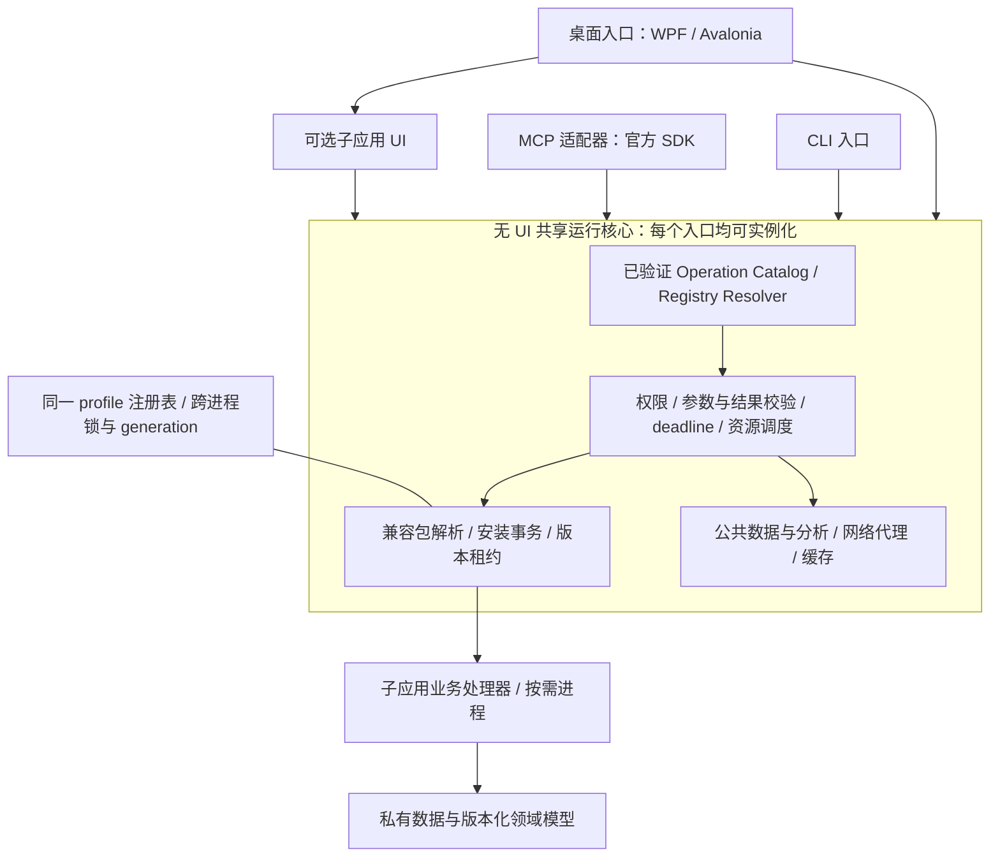

# CLI/MCP 优先的子应用运行架构：补充研究与设计修订

状态：**研究提案，未实施模块化或发布**。日期：2026-11-17（北京时间）。

实施已获授权；执行步骤与逐步提交/验收记录见仓库 [TODO.md](../TODO.md)。本报告的协议实验使用文中固定旧基线；实施已同步后续远端 GEX 改动，当前状态以 TODO 为准。

基线：`work@b863eaa787a3467784f6a10569187738b231a879`。本轮保留上一轮尚未提交的 [55 · 总体研究](55-主程序与可独立更新子应用架构研究.md)，继续检查真实 CLI、官方 MCP SDK、自动化、包和数据目录实现。

## 1. 结论：共享核心必须能脱离桌面运行

结合 CLI/MCP 后，最合适的形态是 **一个无 UI 的应用运行核心、三个入口、多个可独立更新的业务应用**：

- 桌面负责原生窗口和交互，加载业务应用的可选 UI。
- CLI 负责命令、脚本和本地明确的安装维护动作。
- MCP 负责工具/资源/提示的协议适配与权限约束。
- 三个入口调用同一份业务合同与处理器。业务不依赖页面、桌面进程或 WebView。

“主程序 + 子应用”可以继续作为产品叫法，但工程上不能让桌面成为所有业务请求的必经服务端。用户只安装 CLI、关闭桌面、从 Linux 运行 MCP 时，也必须能使用已安装应用的业务能力。

### 相对 55 的关键修订

| 原提案需要深化的地方 | 修订后的原则 |
| --- | --- |
| 图中宿主服务容易被理解为桌面内部服务 | 无 UI Core/Runtime 是共同依赖；桌面只占一个入口 |
| 一个完整 UI+engine 包没有区分 headless 安装 | 一个 app version/release 下，核心/引擎必需，UI 可选；不下载桌面框架或启动浏览器 |
| MCP 会话固定整个包版本 | 公共工具合同稳定，实际执行按请求固定包版本；长期进程不永久阻止补丁升级 |
| 只按 2025 MCP 的初始化/通知讨论 | 保留实测的 2025 模式，按当前 2026-07-28 无状态协议重新设计请求与目录边界 |
| 同一份服务实现等于全局唯一服务 | 区分代码复用、跨进程持久化协调和单一连接；首期不强制通用 daemon |
| 所有操作共用现有一把锁 | 维护资源所需互斥，逐步允许无关的只读/纯计算操作独立执行 |

## 2. 本轮实际验证了什么

### 2.1 生产入口的 headless 验证

重新构建实际 Release CLI，并在临时数据目录启动两个真实 `easysellput mcp serve` 进程，未启动 GUI、未调用真实市场网络：

| 检查 | 实际结果 |
| --- | --- |
| 2025-06-18 初始化模式 | 成功协商与调用 |
| 2025-11-25 初始化模式 | 成功协商与调用 |
| 只读 / 可写目录 | 当前基线分别 36 / 58 个工具；这是观察值，不是未来固定工具数 |
| capabilities resource 与 tools/list | 该连接权限下集合一致 |
| 绕过发现直接调用写工具 | 只读 MCP 返回 `permission_denied` |
| 独立 CLI 新建自选分组 | 已运行的只读 MCP 能重新读取该分组，不需重启 |
| CLI / MCP 定价结果 | 相同参数下业务结果相同 |
| 无 GEX 归档时查询 | `cache_miss`，没有捏造数据或要求打开桌面 |
| CLI 依赖清单 | 无 Meili.Shared、两桌面程序集、Avalonia、WebView2 依赖 |
| stdio / 退出 | stdout 均为合法 JSON；EOF 后退出 0，诊断记录清理 |

证据：[实际 CLI/MCP 与排队测量](app-runtime-research/current-probe.json)。

### 2.2 当前 MCP 无状态协议也做了实际调用

当前官方规范已是 **2026-07-28**，不能将 2025-11-25 误称为最新。用现有生产 CLI、已固定的官方 SDK **2.4.0** 发送每请求 metadata，**未发送 initialize**：

- `server/discover` 成功，当前模式返回支持版本 `2026-07-28`。
- `tools/list` 返回 36 个只读工具，并包含 `ttlMs=0`、`cacheScope=private`、`resultType=complete`。
- `tools/call calculate_option` 成功，正常 EOF 退出，stdout 无杂讯。

证据：[2026 无状态模式实际生产入口调用](app-runtime-research/stateless-probe.json)。这证明当前 SDK/入口有相应基础，不表示现有测试已覆盖所有新协议生命周期、诊断与订阅场景。

### 2.3 两个研究用实验

**当前排队行为：** 使用仓库既有测试宿主与 fixture 行情，不访问 Yahoo。同一 MCP 进程先执行 3 秒行情采样，再发纯定价请求；采样实际约 3.108 秒，纯定价排队约 2.963 秒。原因与 [AutomationService](../src/Meili.Application/AutomationService.cs) 的全局 `SemaphoreSlim(1)` 一致。

取消 10 秒的 fixture 采样后，下一次定价约 0.006 秒完成，服务仍可用。这是单次 Linux fixture 观察，不是行情延迟、原生性能或稳定分位数的保证。不能直接删除全局锁；它也在保护现有可变服务状态。

**官方 SDK 动态工具实验：** 在 `/tmp` 独立构建仅使用 SDK 2.4.0 的研究宿主。在 2025-06-18 和 2025-11-25 两种模式中，工具列表由 2 项增为 3 项，客户端收到了 list_changed；已开始的测试调用保持捕获的 generation 1，新调用使用 generation 2。

证据：[SDK 实验](app-runtime-research/sdk-probe.json)。这仅证明官方 SDK 的传输/handler 机制可行，**不是产品已有独立包激活、文件租约或数据迁移**，也不是 Codex/Claude Code 的真实通知兼容验收。2026 的新订阅通知链没有用这个旧模式实验冒充验证。

## 3. 当前实现对拆分的具体约束

| 当前位置 | 发现 | 架构影响 |
| --- | --- | --- |
| [CLI Program](../src/Meili.Cli/Program.cs) | Parse 阶段先 `OperationCatalog.Find`；help 也在解析数据目录前返回 | 动态应用目录要先做无副作用的全局参数解析，再按选定 profile 发现操作 |
| 同一 Program | SDK stdio 的 tools/prompts/resources 直接读静态集合 | 不仅工具分派，help、resource、指南都要切到统一 resolver |
| [OperationCatalog](../src/Meili.Application/OperationCatalog.cs) | `All` 是静态构建；validator 支持一个有限 schema 子集 | 不能只读外部 JSON 就假设所有 schema 关键字被执行 |
| [AutomationService](../src/Meili.Application/AutomationService.cs) | 一把锁序列化整个服务；持有可变 provider、cache 状态 | 先明确线程安全和资源所有权，再按资源拆调度 |
| [WireJson](../src/Meili.Application/WireJson.cs) | 公开 `schemaVersion=1` envelope、错误码、非有限数值语义 | 插件化不能顺便改掉旧 CLI/MCP JSON 合同 |
| [LocalPaths](../src/Meili.Application/LocalPaths.cs) / [resolver](../src/Meili.Core/Settings/DataDirectoryResolver.cs) | `--data-dir`、便携路径、平台用户目录共同决定数据位置 | 安装注册表必须和实际运行 profile 一致，不可由当前工作目录推断 |
| [McpSessions](../src/Meili.Application/McpSessions.cs) | 注释明确是本地诊断，不是授权与健康信号 | `.mcp-runtime` 不能直接充当可靠的升级锁或权限数据库 |
| [GEX runner](../src/Meili.Application/QqqGexCalculationRunner.cs) | 单次进程、查询 gate、2 分钟内层限制 | 更新要协调跨进程在途任务；外层默认 60 秒先到期仍会取消 |
| [GEX view](../src/Meili.Application/AutomationService.QqqViews.cs) | 64 KiB 默认/最大 256 KiB 分块、SHA continuation；workspace 是最后桌面观测 | 保留完整字节读取，同时为 AI 设计精简领域查询；不能把旧观测当当前屏幕 |
| [覆盖检查](../tests/automation/check_capability_coverage.py) | 严格对照一个编译目录与中心 case 清单 | 应按实际安装模块合并能力清单与每模块案例，不是简单删掉严格检查 |

因此只把 `web/qqq-gex/dist` 移到下载目录，仍不能让 CLI/MCP 的新业务操作独立发布。

## 4. 建议的依赖结构



### 4.1 一个核心实现，不等于一个常驻核心进程

首期仍按当前方式运行：桌面有自己的容器，CLI 命令有短生命周期容器，每个 stdio MCP 服务有自己的容器；共享程序集与合同，数据按 `--data-dir` 协调。没有桌面时不需要启动任何 UI、loopback 页面服务器或常驻 daemon。

可选业务进程是宿主内部受控调用的处理器，不是第二个公开 MCP server。子进程 stdout 由宿主捕获/校验，不能直通外部 MCP stdout；日志限大小并写 stderr。

### 4.2 三种“统一”要分开说

| 目标 | 首期做法 | 不能误称 |
| --- | --- | --- |
| 业务代码统一 | 同一 Application/模块处理器，UI/CLI/MCP 共用 | 不等于同一个进程 |
| 数据与维护统一 | profile 注册表、SnapshotFile、SQLite 事务、跨进程锁与 fencing | 不是一个进程内 Semaphore 就能覆盖多个 harness |
| 实时连接统一 | 桌面模块共用既有 QuoteHub；headless 保留有界采样 | 不承诺所有独立 CLI/MCP 进程只用一个全机器 socket |

多个 harness 同时有界采样，当前可能各建短期 socket。若实际连接数/限流证明有必要，可后续增加可选本地 broker，复用同一核心与 IPC，支持用户级认证、闲时退出与无 broker 回退。**不将 broker 作为子应用独立发行的首要依赖，也不悄悄改变已有持续提醒的桌面所有权。**

## 5. 子应用的定义应以业务能力为中心

### 5.1 一个发行版本，核心必需、UI 可选

子应用发布清单至少描述：ID/version、Host API、engine protocol、公开操作合同、数据格式、权限、运行时及可选组件。

建议逻辑组件：

```text
app-release.json              # 对一个 app version 的全部组件签名
  core                        # 操作描述、领域引擎、模型来源与许可；headless 必需
  ui                          # 可选：页面、组件、图表 worker、字体资源
```

UI 与 core 的兼容关系明确写入同一发行记录，首期要求匹配 app version；它们不是两条任意组合的更新流。CLI/MCP 可仅安装 core，桌面再安装匹配的 UI。纯 UI 源码与测试不得成为 CLI build 的隐式依赖。

第一试点为减少事务复杂度，也可先发布一个同时含 core/UI 的 ZIP，但必须验证 CLI 不载入 UI 或浏览器；将其标成“逻辑 headless 已完成，按组件减小下载尚未完成”，不能提前宣称实现了两个独立组件包。

运行时共用现有固定 Node。core 中没有原生依赖的 JS 可用平台中立 artifact；仍要在所有目标平台执行，不以“JS”推断 SQLite、路径、权限和架构都已兼容。CLI 下载不携带 WPF、Avalonia 或完整桌面安装器。

### 5.2 三类状态不要混淆

- `installed/enabled`：业务核心是否安装并允许使用，适用于三个入口。
- `uiInstalled`：是否有当前版本可用的页面资源。
- `visibleInRail`：只是桌面展示偏好，不应偷偷关闭 MCP 业务能力。

“隐藏入口”“停用应用”“卸载可选界面”“卸载整应用”语义不同，产品不必同时在首页暴露四个按钮，但管理流程必须区分。无 UI 的已安装 GEX 可以正常出现在 CLI/MCP 目录；卸载整个应用则不能继续执行它的 engine。

### 5.3 业务 API 不依赖展示状态

当前行情/归档/计算可以 headless。窗口打开、选中的表格行、当前分屏、最后看到的 tooltip 则是桌面展示信息。允许读取带时间戳的已保存展示偏好，但没有桌面时不得伪造“当前屏幕”。

GEX 的 `workspace` 返回最后桌面观测已有明确 coverage，必须保留这个含义。可视化研究内核可以作为业务 API 复用，但接口应返回数值、标记、来源和覆盖，不要求先在 DOM 上画出同一张图。

## 6. 公共操作合同：比包版本更稳定

### 6.1 建议的合同模型

```text
PublicOperationContract
  ownerAppId / publicName / contractMajor
  inputSchema / outputSchema / validationDialect
  effects: read | write-user-data | record-observation | maintenance
  limits / cancellation / retry semantics
  domain meaning / provenance rules

InstalledImplementation
  appVersion / modelVersion / packageHash / supportedContractIds
  engine entrypoint / required host capabilities / data formats
```

签名保护合同与实现映射。schema/hash 可以检测变化，不能自动证明语义兼容；同名工具突然改定价基础、读写属性或数据含义，即使 schema 没变也属于破坏性改变。

只支持经过宿主验证的 schema 子集。先将现有 validator 实际支持范围形成明确 dialect；需要更多 JSON Schema 功能时使用统一经过验证的实现。未知 `$ref`、深度、正则或其他关键字不能被静默忽略，也不允许远程 schema 解析。

### 6.2 新版本如何兼容旧脚本和旧模型上下文

- 保留已承诺的命令、工具名称和参数/结果结构；现有 GEX 工具变成 facade 后仍执行原合同。
- 相同合同的补丁可以更新 handler；在途调用绑定启动时的版本，之后的新请求解析新版本。
- 新增能力增加新操作或兼容的可选字段；工具列表更新并标明新目录 revision。
- 破坏性操作合同引入新版本名称或显式版本接口，旧名继续由经测试的兼容处理器支持；做不到则返回明确不兼容，不能把旧请求硬套新 schema。
- `read → write` 不能当作普通补丁。不得因包换版让原只读工具产生业务写入；应使用新写操作并重新经过权限过滤。

不建议将 MCP 压缩成一个 `invoke_app(app, method, json)`：这样会丢失每项操作的类型、读写提示、细粒度发现和审核边界。CLI 可以复用通用 schema 驱动解析，但外部 MCP 仍注册具体、明确的工具。

## 7. 当前和旧版 MCP 协议都要正确

### 7.1 规范差异

| 范围 | 已验证的 2025 模式 | 当前 2026-07-28 模式 |
| --- | --- | --- |
| 协议入口 | initialize + initialized | 每请求 metadata；可用 server/discover 探测 |
| 能力/客户端信息 | 初始化交换 | 每请求携带；不得由前次调用推断 |
| 工具变化通知 | listChanged 声明与 list_changed | 显式 subscriptions/listen；通知与订阅关联 |
| 目录缓存 | 不依赖新增缓存字段 | cacheScope / ttlMs / resultType 等由 SDK 正确输出 |
| 跨调用状态 | 仍应避免依赖隐式对话 | 需要时用明确句柄作为工具参数；同进程不代表同对话 |

由官方 SDK 处理各协议模式，内部 dispatcher 保持同一业务语义。子应用升级不要求同时升级外部 MCP 协议；Host API semver、engine protocol 与 MCP 日期版本是三套不同的兼容维度。

### 7.2 目录是 endpoint/profile 的当前能力，不是客户端隐藏状态

当前规范要求 tools/list 在相同授权下不能因同连接之前调用过什么而改变；可以因实际安装/启用状态改变，或因请求授权不同过滤。

建议目录由 **实际 profile、宿主可提供能力、已启用且兼容的模块、宿主权限策略** 计算。stdio 的 `--allow-writes` 和可选应用范围是启动时的本地管理策略，不是由 clientInfo、clientCapabilities 或任意参数授予的权限。

UI 支持能力只影响是否提供可选展示元数据，不赋予写权限。多个对话可以复用一个 stdio 进程，每个请求都必须有完整的有效执行上下文。不能用上一次工具调用选中的 symbol、日期或策略替代本次缺失参数。

### 7.3 目录分页、缓存与刷新

- 目录按稳定顺序输出，保持 prompt cache 友好；不要按最近使用或随机顺序抖动。
- 一次分页读取绑定明确 catalog revision/hash，cursor 只表示该快照的位置，不表达任意文件路径或权限。
- 读完工具目录、capabilities resource、CLI help 所用集合和过滤规则一致。
- 对 2026 list result 使用私有缓存语义与合理 TTL；应用状态变化失效目录缓存。TTL 针对工具定义，不是报价新鲜度。
- 2025 通知和 2026 订阅分别经官方 SDK 验证；不对未订阅的新协议客户端随意推送。
- 客户端不刷新时，稳定旧合同继续可用；新增工具可能需重新发现或重连，不能承诺每个 harness 自动出现。

首期允许保守地提示重读目录/重连来发现新增工具，但不将重连作为所有兼容业务补丁生效的条件。

## 8. 代码租约、数据锁与 MCP 进程不是同一件事

### 8.1 修正“长会话锁死更新”

不能让一个闲置的 Claude Code/Codex MCP 进程占用 GEX 旧包数天。应拆分：

| 类型 | 生命周期 | 阻止什么 |
| --- | --- | --- |
| 传输/诊断记录 | stdio 进程存在期间 | 仅用于状态显示，不能单独证明业务占用 |
| 目录缓存 | 显式 revision/TTL | 管理发现，不自动持有执行文件 |
| 执行版本租约 | 单次操作或实际活跃 UI | 阻止删除正在执行的旧包 |
| 数据读/写租约 | 实际读写事务或有界计算需要期间 | 阻止不兼容迁移；保护 snapshot 一致性 |
| 安装事务锁 | 验证/激活/维护的具体阶段 | 防两个安装者覆盖注册表 |

### 8.2 各类更新的行为

| 改动 | 在途请求 | 新请求 | 用户动作 |
| --- | --- | --- | --- |
| 同合同、同数据格式补丁 | 原版本执行到完成/取消 | 激活后用新实现，仍遵守旧合同 | 通常不需重启 MCP；若 UI 仍持有旧包，重开该应用 |
| 新增工具 | 已开始的操作不变 | 当前目录暴露新工具 | 支持者刷新；其他客户端重新发现/重连 |
| 破坏性合同 | 原合同保持或明确失败 | 新版本工具/兼容适配 | 更新脚本或使用新工具，不静默重解释 |
| 数据迁移 | 等实际数据租约释放 | 迁移期间返回可恢复 busy/pending | 显式更新流程执行迁移，不在普通读操作里执行 |
| 停用/卸载 | 按既定取消/完成策略释放 | 不再派发到已停用包 | 默认保留数据；旧包等无执行者后删除 |

首期可以在实际租约全部释放后再激活，避免两版同时写同一库。需要更平滑的多版本并存时，必须先证明只读格式兼容与正确的写入 fencing，不默认开启。

### 8.3 真实跨进程协调

现有 `.mcp-runtime` 是诊断文件，30 秒过期不表示一个暂停/卡住的进程已经停止写数据库。进程内 QueryGate 也不能锁住另一个 MCP 进程。

需要本地可靠的锁/租约、进程启动身份、注册表 CAS 和持久 generation。每次开始操作重新检查启用状态与有效 app version；写入提交前检查属于当前 generation。更新失败、取消和进程崩溃都必须释放或可安全回收占用。

在旧客户端尚未支持新租约协议的过渡期，不能声称自动协调已完善。首次迁移须识别旧进程并明确等待其关闭，或要求用户完成一次新宿主安装；不依赖旧 MCP 心跳做“无活跃写入”的唯一依据。

## 9. CLI 命令与自动发现

### 9.1 两阶段解析

当前 CLI 在数据目录解析前读静态 OperationCatalog。新流程应为：

1. 无副作用解析 `--data-dir`、输出模式、超时、help/version、MCP 模式等宿主参数。
2. 解析唯一 profile 和只读注册表，加载可信操作 metadata；此时不启动 engine、不探测市场网络、不迁移业务数据。
3. 按该目录解析具体命令、别名、JSON 输入与 schema。
4. 校验权限和参数，取得实际执行版本/数据租约，再启动需要的处理器。

基本 `--version`、宿主帮助与安装诊断即使某个 app 破包也必须可用。某 app 的坏 metadata 不应拖垮所有无关工具；隔离该 app 并给出可恢复的诊断。

### 9.2 推荐命令形态

以下为拟议接口，并未在产品中实现：

```sh
easysellput apps list --json
easysellput apps info easysellput.qqq-gex --json
easysellput apps install easysellput.qqq-gex --components core --json
easysellput apps update easysellput.qqq-gex --json
easysellput apps doctor --json
```

业务继续支持现有公开操作名及别名，例如 `get_qqq_gex_replay`；未来可增加容易阅读的命令组，但不迫使现有脚本迁移。app ID 由受信目录解析，不接受任意 URL、系统脚本或安装后命令。

本地明确执行 CLI 维护命令可安装/更新子应用；无需先启动 GUI。**这不改变现有主程序整包安装仍需桌面确认的规则，也不通过 MCP 暴露代码安装。** 长期主 CLI 自身升级是另一项宿主发行流程，不跟每个 app 补丁一起替换。

## 10. 数据目录、多个宿主版本与安装身份

### 10.1 安装在哪个 profile，三个入口就从哪里读

桌面、独立 CLI、`.app` 内 CLI、便携 CLI、MCP 配置都应使用同一 resolver，显式 `--data-dir` 最高优先级。默认目录只有在实际解析一致时才共享，不通过扫描磁盘猜测用户想用哪一个。

诊断至少返回：数据目录和来源、宿主版本、CLI 可执行路径、注册表 revision、每个应用的 installed/preferred/effective version、runtime、能力和不兼容原因。不同 data-dir 的缓存/数据/工具集合可以不同，不能静默切换目录来“修复”缺应用。

首期将 app 注册与代码安装按 profile 隔离，避免全局安装状态侵入测试或便携目录。以后可共享只读的内容寻址包缓存以省空间，但激活指针、数据、权限和卸载语义仍按 profile 管理。

### 10.2 桌面新、CLI 旧不能只看一个全局 active 指针

同一数据目录可能被不同版本的 GUI/CLI 使用。建议记录全局 preferred version，但每次执行还要核对实际宿主的 API/runtime/数据能力，返回 effective version 和原因。

首期不兼容就明确拒绝，不静默退回另一个旧 engine 继续写新版数据库。需要同时支持旧宿主时，发行包明确提供经测试的兼容范围/处理器。离线旧 CLI 再次启动也不能绕过当前数据格式检查。

app 更新不改 MCP 的 `command` 路径或让每个 app 新增一条 harness 配置。保留单一稳定 `easysellput mcp serve` 入口，新增应用通过真实目录发现。

## 11. 权限、读写与审计

### 11.1 按三个层面校验

1. **公开操作合同**：这是读、用户记录写入、观测记录还是维护操作。
2. **实际调用上下文**：本地明确 CLI 命令、桌面用户动作、只读/显式可写 MCP，以及已批准的能力范围。
3. **业务执行环境**：处理器获得受限宿主 API、只读/可写数据连接、deadline 和 generation。

`readOnlyHint` 等注解只帮助客户端理解，不是服务端权限控制。清单声明写权限也不是执行授权。`--allow-writes` 允许业务写操作，不授予安装包、任意文件、任意命令或账户交易权限。

MCP 的 clientInfo/capabilities、工具参数中的 `allowWrites=true`、iframe 消息或旧诊断文件不能提升权限。不能让只读子引擎回调一个通用宿主代理，再从那里偷偷调用业务写服务。

### 11.2 “只读”需要准确划分

只读模式不记录新的 IV/OI、GEX 市场观测、提醒、用户策略或历史重建结果。必要的进程诊断、租约和可丢弃读取缓存可以作为宿主技术状态管理，必须明确范围；不能以“缓存”为名持久化新的业务观测。

读取归档可使用只读 SQLite 连接；写入由明确业务操作与事务执行。Node 进程隔离和权限模型仍不等同于恶意代码沙箱，首期只接受项目签名的一方模块，保留 55 的信任边界。

### 11.3 跨入口诊断与执行记录

内部每次执行记录 operation/contract、app/model/package version、profile 标识、request ID、generation、权限模式、结果状态及源时间，不记录 token、代理凭证或完整敏感参数。

CLI `apps info/doctor`、MCP capabilities resource 和桌面诊断读取同一模型。原公开 WireJson v1 envelope 与已有 GEX `data` 不任意重包；新元信息通过新诊断接口或有明确版本的返回合同提供。不能因为想附加版本，就把老 `/data/...` 整体改成 `/data/result/...`。

错误值沿用现有小写风格。已知未安装应用、缺 runtime、不兼容、繁忙/待更新等新增错误家族先定义兼容退出语义；既有错误、退出 2/3/4/130 含义不随意改变。未知拼错的操作名仍是参数错误，不能自动下载“可能想要”的应用。

## 12. 并发、性能与长任务

### 12.1 逐步替换全局串行，不直接拆掉锁

建议按以下资源建可组合调度：

| 操作类型 | 调度策略 |
| --- | --- |
| 纯 Analytics 计算 | 有界并行，与 GEX 网络/归档任务分开 |
| 只读归档查询 | 有界读取，复用一致 snapshot；避免重复大对象复制 |
| provider 请求 | 共享路由/合并/限流；多个进程总预算另行协调 |
| 用户 JSON 修改 | SnapshotFile 的事务/修订冲突 |
| 同 app 数据写入/迁移 | 按 profile/app 的跨进程互斥与 generation |
| 重型 GEX import/replay | 有界计算预算和队列，不无限启动多个 Node |

多个 MCP 都请求相同重型计算时，不能仅靠每进程 gate 防止内存叠加。至少用跨进程计算配额；对相同版本/模型/输入 revision 的纯计算可复用已验证结果，前提是不把不同日期、策略或质量状态混为一个 key，也不违反只读语义。

### 12.2 超时是端到端预算

当前 CLI/MCP 默认 60 秒，GEX 内层进程最多 2 分钟，部分采集预算 90 秒；内层更长不表示默认请求能运行那么久。队列等待、下载公共输入、计算与序列化都消耗调用方 deadline。

首期保留有界分页/分块和可取消的小批次，给出明确重试/继续信息；进度通知不自动延长 deadline。长任务若需脱离单次请求，使用明确的 job handle 和固定业务工具，状态与权限按每次请求校验，不能把“同一个 MCP 进程”当 job 身份。

历史重建已有按输入提交/失败记录语义，模块化要保持；取消不能伪称整批回滚，也不能无提示在后台继续写。只读任务禁止因为转成 job 而触发持久业务写入。MCP Tasks/新多轮协议属于可选适配，不是所有 harness 运行业务的前提。

### 12.3 AI 数据传输应与图表字节传输区分

现有 GEX SHA 分块接口保留，供精确还原与审计；默认 64 KiB、最大 256 KiB 分块经 base64 后还会增大，且当前 TextContent/StructuredContent 逻辑上各有一份结果。

面向研究任务，优先增加有意义的 summary、筛选和时间窗口查询；返回数值、来源、质量与需要的少量 evidence，不把完整 heatmap、UI tree 或所有曲线点默认塞进模型上下文。需要时再取原始分块，不能通过截断省 token 后仍宣称“完整历史”。

金融 provenance、盘前后/夜盘语义、history/live 缺口、模型假设与 missing/null 规则跨 UI/CLI/MCP 保持一致。不能为了让各入口看起来都有值而补造数据。

## 13. MCP Apps 是可选展示入口，不是安装架构

官方 MCP Apps 可通过工具 `_meta.ui.resourceUri` 指向 `ui://` 资源，由支持的 harness 在受限 iframe 中渲染交互 UI。本轮已在线核对官方 overview；未安装扩展包或声称某个用户 harness 已验收。

适合后续暴露小型 GEX 摘要、策略盈亏图、流动性热力图等。它可以复用领域展示模型、设计组件和部分 UI 代码，但**不能原封不动把本地 WKWebView 页面当成 MCP UI 资源**：

- 桌面私有 Host API 与 MCP Apps 消息桥不同，应分成适配器。
- 当前多文件资源、Web Workers、持久偏好、CSP、字体、图表体量和可用 viewport 要逐项验证。
- iframe 不运行本机 Node、不拿桌面 token、不直接读数据库或下载业务更新。
- 交互写入仍经公开工具与实际请求权限，不能用 UI bridge 绕过只读模式。
- 不支持 MCP Apps 的客户端仍获得完整的文本/结构化业务能力；CLI 完全不依赖 UI 扩展。

官方支持列表会变化，Codex、Claude Code 的不同客户端/版本也不能混为一谈。保持当前统一 stdio 配置，是否另加 HTTP 或 MCP Apps 是单独经明确需求和原生/真实 harness 验收的后续工作。

## 14. Skills、资源与可用工具发现

继续一个宿主 companion skill，说明怎么发现当前工具、单位、质量、权限和恢复流程。应用文档/领域例子随签名包，通过只读 resource 暴露，避免每个 app 都要求用户重新安装一个 MCP server 或复制新命令。

新 workflow 只能推荐实际已安装、兼容且该调用方有权使用的操作。卸载 GEX 后不能让旧资源继续告诉模型调用它，或暗示可以用 shell 绕过缺失工具。包内说明是参考资料，不是授权凭据，不能提升为安装/写入指令。

应用多时可提供显式固定的 endpoint 应用 allowlist 来减小上下文，但它只限制可见范围，不提高权限；默认行为与 `--data-dir` 一起清楚记录。目录缓存与工具描述保持稳定，避免频繁改变同一工具的长篇说明破坏缓存。

## 15. 发布与 CI 应按业务核心验收

### 15.1 发行单元

首期一个源码仓库、一个公共运行核心、每 app 自己的版本与签名 release。核心与 UI 可选组件都绑定经过测试的 app release，而非每次改 React 页面就重新发行 CLI。

CI 主程序仍四桌面/五 CLI 目标，app core 在对应 headless 目标原生执行；UI 在 WKWebView/WebView2 原生验收。新 app UI 可以晚于 core 安装，但不能和不兼容 engine 混装。保持仅 main 准备/公开发行、复用 CI artifacts 和 55 中 app 不占用主 Release Latest 的规则。

### 15.2 能力覆盖的改法

`check_capability_coverage.py` 的严格约束保留，但输入改为已验证实际安装集合：宿主案例 + 各 app 的案例与 inventory。每个公开操作仍有一个有意义的 CLI/MCP 场景，验证真实处理器、权限、错误与结果一致；不能把一个通用 invoke 的测试说成覆盖所有动态操作。

测试用签名包和信任根通过独立测试宿主注入，不能给生产客户端增加“跳过签名”的环境变量。测试代码、fixture、Node 安装脚本不进入 app 发布包。

### 15.3 新增验收矩阵

| 组别 | 必须验证 |
| --- | --- |
| Headless | 干净 CLI 安装，无桌面框架、无系统 Node、无 GUI/WebView，运行 app core |
| 多入口一致 | UI/CLI/MCP 同输入同模型/来源结果；展示例外有时间戳与 coverage |
| 协议 | 当前生产支持的 2025 两模式与 2026 每请求模式；metadata、无握手、错误与 EOF |
| 目录 | CLI help、tools/list、capabilities 同一过滤/合同；分页一致、排序稳定、私有缓存失效 |
| 通知 | 2025 list_changed、2026 显式订阅，支持/不刷新客户端均安全；实际 harness 另测 |
| 兼容升级 | MCP 长期运行时兼容补丁可生效；在途调用版本固定，不要求退出空闲 MCP |
| 合同变更 | 新工具、旧 schema 缓存、删除/破坏性变更、read→write、旧 alias 的真实行为 |
| 多进程 | GUI + CLI + 两 MCP，同/不同 data-dir；安装/写入/查询/迁移/缓存清理竞态 |
| 多宿主 | 新 GUI + 旧 CLI、便携 CLI、`.app` 内 CLI、旧离线宿主，明确 effective version |
| 权限 | 直接调用隐藏写工具、伪造 clientInfo/capabilities、子引擎回调越权、UI bridge 越权 |
| 资源 | 3 秒慢请求不阻塞无关纯计算的目标；有界队列/输出/进程/内存与跨进程配额 |
| 取消 | 排队取消、网络取消、计算取消、提交边界取消、EOF/父进程退出，业务状态准确 |
| 安装维护 | 独立 CLI 安装/更新/卸载；只读 MCP 不安装；core-only、UI 后装与版本匹配 |
| 业务数据 | GEX 原始记录、IV/OI、历史、策略、自选、网页会话保留；无新伪造观测 |
| 金融与 live | 同 symbol 订阅、盘前后/夜盘、history/live handoff、来源和缺口跨入口一致 |
| MCP Apps（可选） | 有/无扩展支持、CSP/Worker/resize、只读交互回退，不能替代 headless 测试 |

## 16. 建议重新排列实施顺序

1. **先处理当前 CI 导航红项并固定业务基线。** 该失败与本轮研究不是同一个验证范围，不能隐去。
2. **先建立无 UI 的 Operation/Registry/Dispatcher 边界。** 验证 CLI 在临时数据目录能发现和调用测试业务包，桌面程序集不进入依赖图。
3. **GEX core 真正独立。** 宿主中的领域 schema、路由、存储知识收敛到 GEX，公共市场/分析仍复用；保留旧公开操作 facade。
4. **MCP 接入同一 resolver。** 同时测旧模式与当前无状态模式，先稳定合同和每请求执行版本，再实现通知优化。
5. **桌面挂接可选 UI。** 原生 AppView、动态导航、主题和生命周期按 55 复用；测试 core-only → 补 UI。
6. **安全升级/卸载、并发与 CI 发行。** 验证长期 MCP 进程不阻止兼容补丁，真实多进程数据完整。
7. **第二个应用验证复用收益。** 达到这些目标后再考虑 broker、跨仓库、MCP Apps 与第三方扩展。

核心验收示例：固定宿主二进制/CLI 路径，桌面关闭，只装 GEX core；CLI 与 MCP 均可运行；在 MCP 进程持续存在时更新一个同合同补丁，新请求使用新版，旧请求完整结束；旧 JSON 合同、历史数据和只读权限保持有效。随后只添加 UI 组件即可在桌面打开同一业务应用。

## 17. 本轮产物与实测边界

- 实际生产 CLI build 与既有 fixture host build 均成功，0 warnings / 0 errors。
- 生产 CLI/MCP 的无 UI、权限、跨进程重读、JSON 一致与 2026 无状态调用通过本轮定向验证。
- 排队/取消为既有测试源；SDK 动态工具为临时研究宿主，不是行情 live 或模块化产品证明。
- 只修改研究文档和附带 JSON 证据，未修改产品运行代码、AGENTS、操作合同、CI 或安装数据，未推送/发布。
- 未重跑所有桌面和发行矩阵，未声称当前 work CI 已绿，未验收真实 Codex/Claude Code 热更新、2026 通知订阅或 MCP Apps UI。
- 本轮查过的部分猜测 SDK 文档 URL 返回 404，没有把它们作为依据；SDK 机制通过本地固定版本 XML/README 和真实临时进程核对。

## 18. 参考资料

以下官方资料本轮在线访问成功；当前规范与旧兼容模式分别引用，不混用生命周期规则。

1. [MCP 2026-07-28 主要变化](https://modelcontextprotocol.io/specification/2026-07-28/changelog)：无状态、每请求 metadata、server/discover、新订阅和缓存语义。
2. [2026 基础协议](https://modelcontextprotocol.io/specification/2026-07-28/basic)：同连接不等于会话；显式状态标识。
3. [2026 Tools](https://modelcontextprotocol.io/specification/2026-07-28/server/tools)：目录不依赖之前连接操作、稳定排序、缓存与工具定义。
4. [2026 stdio](https://modelcontextprotocol.io/specification/2026-07-28/basic/transports/stdio)：每请求元数据、旧协议探测与 stdio 边界。
5. [2025 Lifecycle](https://modelcontextprotocol.io/specification/2025-11-25/basic/lifecycle) / [Tools](https://modelcontextprotocol.io/specification/2025-11-25/server/tools)：已实测兼容模式的初始化、发现和通知。
6. [2025 Cancellation](https://modelcontextprotocol.io/specification/2025-11-25/basic/utilities/cancellation) / [Transports](https://modelcontextprotocol.io/specification/2025-11-25/basic/transports)：取消与 stdio stdout/stderr 规则。
7. [官方 C# SDK](https://github.com/modelcontextprotocol/csharp-sdk)；本仓库锁定 2.4.0，本轮使用本地该版本 API 与进程实验，而非假定 main 分支源码完全一致。
8. [MCP Apps overview](https://modelcontextprotocol.io/extensions/apps/overview) / [API](https://apps.extensions.modelcontextprotocol.io/api/)：ui://、受限渲染、桥接与支持差异；不是本地应用包管理标准。

55 中的 macOS 签名、主更新源、数据回退、设计系统和仅 main 发布规则继续适用；本补充优先决定共享运行核心与 CLI/MCP 协议边界。
