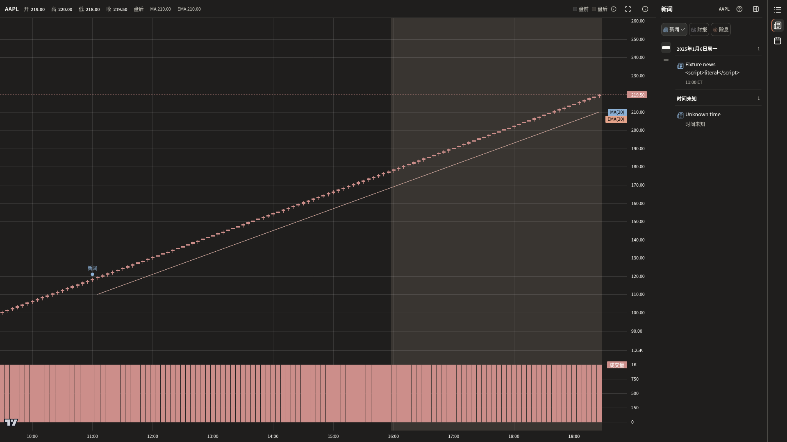
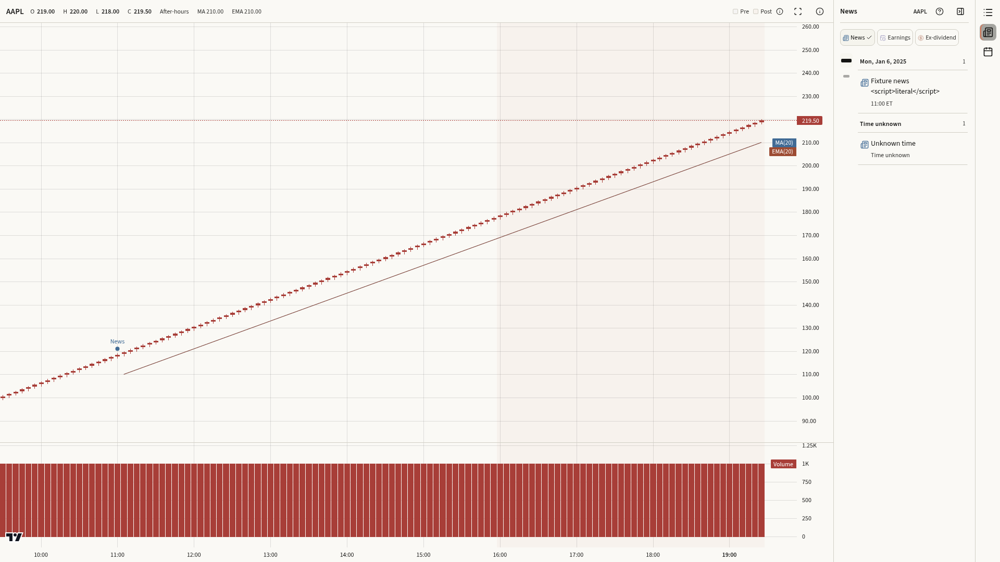
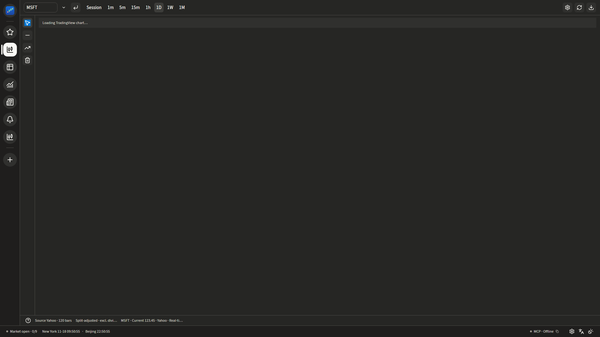

# TradingView 风格图表工作区

## 参考与边界

2026-11-18 读取 TradingView 官方 [How to configure your Supercharts](https://www.tradingview.com/support/solutions/43000748166-tradingview-supercharts-all-you-need-to-know/) 页面，参考其顶部工具栏、左侧画线工具、右侧可展开工具栏和图表优先的信息层级。继续使用本项目 Claude 配色、字体、Lucide 和组件，不增加未实现的交易、脚本或回放按钮。

核心包仍为 easysellput.charts；本次修改宿主共享的原生组合和私有渲染器。八项 CLI/MCP 操作、财务计算、行情连接、LiveBarStitcher、历史缺口、事件时间、分屏和画线存储没有迁移或改写。

## 调整

| 区域 | 改动与用途 |
| --- | --- |
| 顶部原生工具栏 | 周期使用共享 ChartInterval；指标、刷新、导出改为等大图标按钮，保留名称、tooltip、禁用状态和键盘操作 |
| 左侧 | 72px 缩为 48px；四个 32px 图标工具：平移/选择、水平线、趋势线、清除。新增平移入口复用 CancelDrawing，取消未完成手势，不删除已有画线 |
| 图表图例 | OHLC 优先，缺值仍显示 —；指标和交易时段作为次级信息。悬停继续显示对应 K 线，不用实时 tick 改写历史 OHLC |
| 适应窗口 | 使用 Lucide Scan 图标；保留原 autoscale/fit 行为、双语名称和键盘焦点 |
| 右侧 | 默认 320px，图标轨道 48px。点击当前轨道入口可折叠/展开；也可从标题栏收起。宽屏默认展开，首次窄于 640px 默认收起 |
| 连续操作 | 折叠不清除筛选、阅读位置和事件选择；等待图表 autoSize 后恢复逻辑区间，避免重置缩放。点击图表事件会重新展开对应列表 |
| 帮助 | 数据范围改为标题栏 Help 图标，复用共享 AppPopover：视口内定位、Esc、焦点返回、减少动态。英文长标签不挤压帮助按钮 |
| 维护 | CSS 从 index.html 分离为 chart.css；颜色/字体/尺寸仍来自统一资源。Cursor、Fit、PanelRight 来自已验证的 lucide-static 1.73.0，保留许可证和校验值 |

只对控件悬停、按下等小型状态使用现有动效；不动画行情数值、K 线、原生 WebView 或侧栏宽度。

## 检查与回归

- Shared 157 通过，包括所有内置页面都有导航向量。图标生成器此前没有保留 QQQ GEX 别名，导入新图标时暴露并修复；没有将运行时缺失导航当作正常状态。
- 真实 Chromium 20 项通过，包括原画线/事件/实时/盘前盘后/期权工作台及新侧栏键盘、范围保留、OHLC、窄屏、帮助焦点和英文边界检查。
- Python 80、生成资源检查和主分支发布策略检查通过；完整 Windows 测试项目跨编译通过。跨编译不是原生执行。
- 原生 Mac 完整套件 152 项通过，覆盖明暗/中英/紧凑及 1920×1080 原生控件布局；最终提交 CI 状态在提交后记录。不将待执行的 Windows/macOS WebView、安装包/更新器或 ARM runner 排队记为通过。现有 CI 已发现全部测试，无需新增弱化或重复工作流。

## 1920×1080 截图

下列两张来自真实 Chromium → C# 私有 HTTP 通道 → 生产图表渲染器；行情和新闻是测试数据，不是 live 验收。新闻中保留的字面 HTML 是注入安全 fixture。

下图为 Avalonia headless 的实际原生控件布局，用于检查工具栏、图标和对齐；图表区域是平台占位，不代表 WKWebView 实际渲染，也没有将两种截图拼接伪装成原生完整运行。

