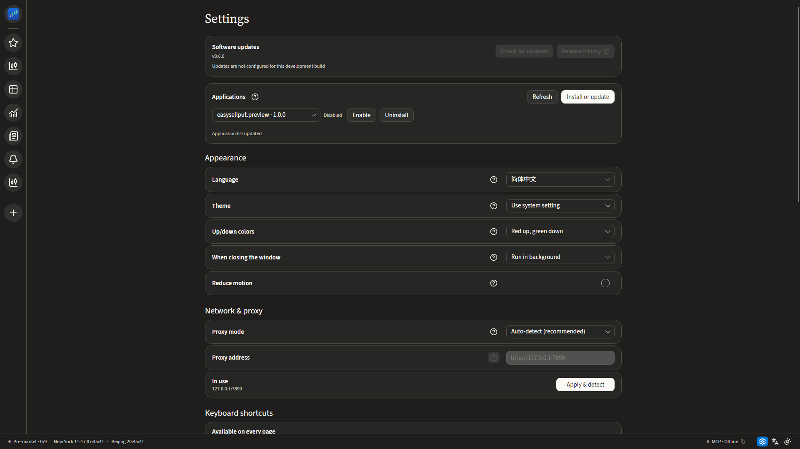

# Local application management

Settings → Applications installs or updates a local `.espapp` signed by the repository/key compiled into this host. Select an installed app to enable, disable or uninstall it. Close its active page/tasks first: maintenance does not interrupt a running financial calculation. Uninstall retains observations, preferences, data and immutable package backups; explicit reinstall is required to restore a removed compatibility seed. Core-only packages do not add an empty desktop entry.

Discovery and enable verification are asynchronous. The UI and CLI share ModuleInstaller; installation is never exposed as an MCP tool. Application code is first-party signed code, not a sandbox for untrusted extensions. Development builds with no compiled update repository do not accept externally supplied packages.

The screenshots below are actual 1920×1080 Avalonia/Skia **headless renders**, with a metadata-only preview row. They are not native macOS/Windows WebView acceptance or real signed distribution evidence. Both language/theme pairs and compact layout are exercised in `ApplicationPanelTests`; existing form-alignment checks remain intact. Windows has matching native tests in the full WPF suite.

Pending pilot acceptance, including remaining GEX facade ownership, optional UI attachment, proactive MCP catalog notifications and final signed/native packages, is tracked explicitly in ../../TODO.md. This page describes current local maintenance behavior, not completion of S01–S12.
