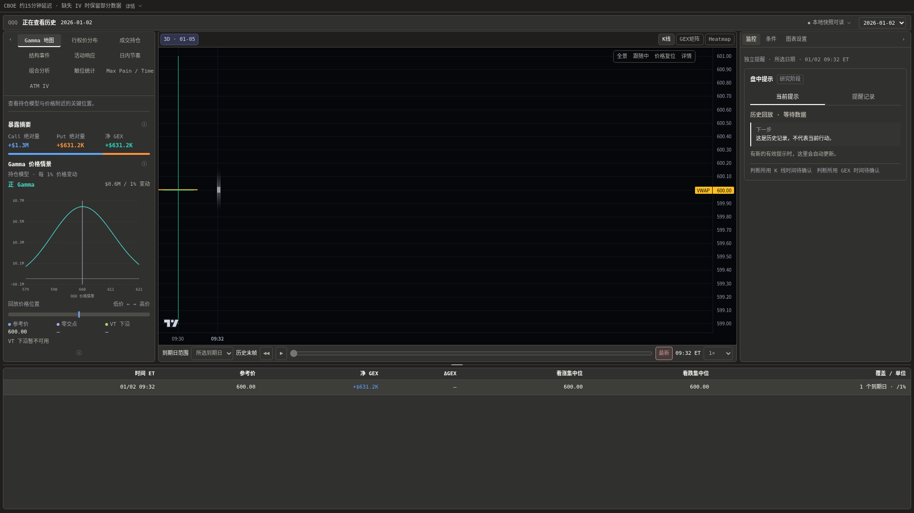
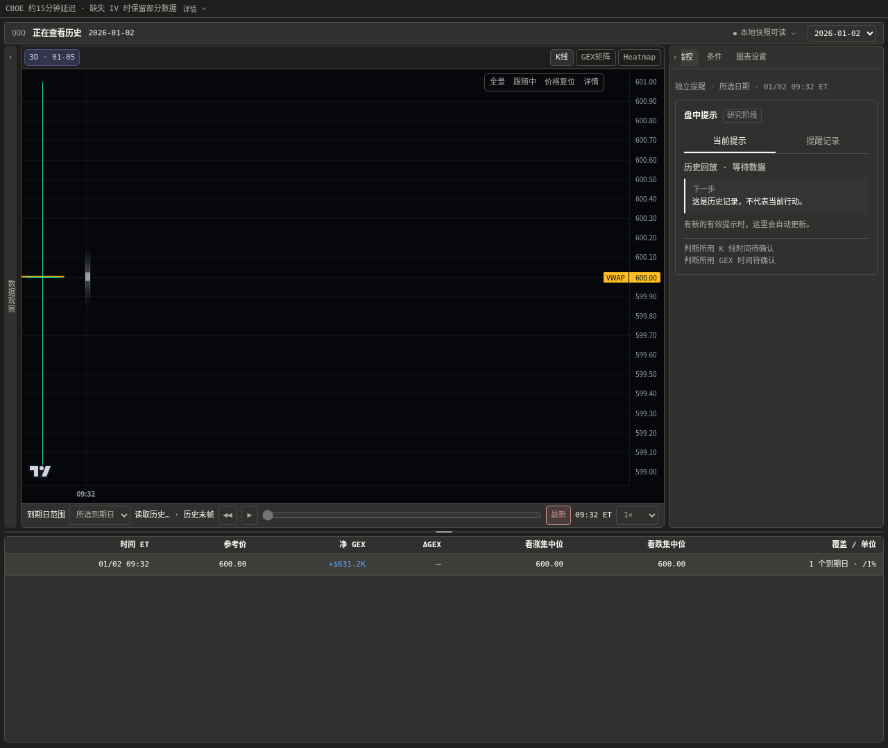
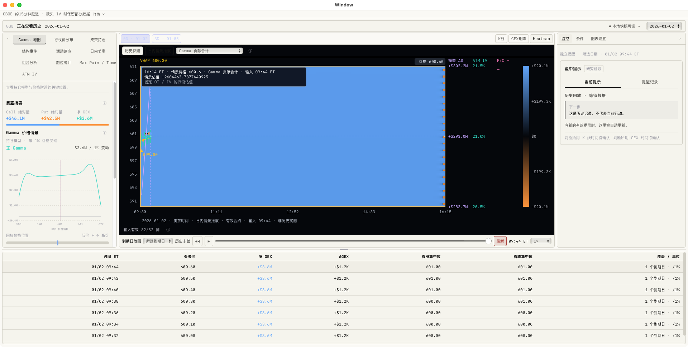

# Local application management

Settings → Applications installs or updates a local `.espapp` signed by the repository/key compiled into this host. Select an installed app to enable, disable or uninstall it. Close its active page/tasks first: maintenance does not interrupt a running financial calculation. Uninstall retains observations, preferences, data and immutable package backups; explicit reinstall is required to restore a removed compatibility seed. Core-only packages do not add an empty desktop entry.

Discovery and enable verification are asynchronous. The UI and CLI share ModuleInstaller; installation is never exposed as an MCP tool. Application code is first-party signed code, not a sandbox for untrusted extensions. Development builds with no compiled update repository do not accept externally supplied packages.

The screenshots below are actual 1920×1080 Avalonia/Skia **headless renders**, with a metadata-only preview row. They are not native macOS/Windows WebView acceptance or real signed distribution evidence. Both language/theme pairs and compact layout are exercised in `ApplicationPanelTests`; existing form-alignment checks remain intact. Windows has matching native tests in the full WPF suite.

The [pilot acceptance report](pilot-acceptance.md) records GEX ownership, exact-revision CI, screenshots and delivery limits. The chronological [migration checklist](../../TODO.md) preserves intermediate failures separately from accepted results.

## Reusable application pages

Enabled signed UI modules can contribute a desktop rail entry. Both platforms use `PrivateAppSession` and a native `PrivateAppView` adapter. The private loopback origin serves only declared signed files and app-owned operations, with a random token, strict origin checks, bounded clients/requests and the shared dispatcher permission/schema rules. Remote article and personal website views have no access to it. Hidden pages release their native view and cancel requests; execution leases remain held until those requests finish cancellation.

`web/app-sdk/client.mjs` provides browser discovery/invocation without sockets or market polling. `tools/Meili.AppDev` is a separate source-development executable: temporary profiles, explicit development public key, read-only operation execution and private UI preview. It is never shipped in a production package and cannot select an existing data directory. The original GEX page now uses the same UI-free application session as its native adapter; see [development instructions](../../tools/Meili.AppDev/README.md) for explicit seed/theme/language options.

## Shared presentation

`AppViewPresentation` projects the existing design tokens, language and reduced-motion setting. Signed private pages read `host/presentation` or use the browser SDK's cancellation-owned `presentationChanges(signal)` iterator. Updates wake pending requests; unchanged state does not trigger another redraw. There is no extra quote timer, remote connection or UI preference write endpoint. Hidden page disposal cancels pending waits and detaches theme/language/motion handlers.

The browser SDK's `applyTheme` is now reused by the original GEX adapter. It compares actual tokens before requesting chart resize, so ordinary quote/status events cannot repeatedly resize an unchanged chart. Original kernels and palette definitions are retained.

This is a computed fixture screenshot, not live-market or native WebView evidence. Chromium empty/computed journeys verify no remote requests or script errors, preserved document/history selection, expiry switching and live theme/reduced-motion updates.

The existing GEX page also exposes the same scoped `host/catalog`, `host/invoke` and read-only presentation contract when the desktop explicitly injects its shared dispatcher. Only authenticated operations belonging to GEX appear; it cannot proxy unrelated host tools. Its legacy chart endpoints and QuoteHub channels remain compatibility adapters; the eight public GEX operation handlers and contracts are owned by the signed app package. Native app/profile mismatch and core-only UI startup are rejected before opening financial storage.

## Shared original GEX document host

`Meili.Application/Apps/QqqGex/QqqGexAppSession` owns the original page's bounded private document server. Native `QqqGexSession` is a presentation adapter; AppDev reuses the same server without desktop assemblies. Generic and GEX sessions share request parsing, operation scope, presentation snapshots, bounded request draining and one-time execution-lease release. Generated `app-theme-defaults.json` comes from the existing design tokens; native overrides preserve user-selected market colors. Mutable presentation snapshots never modify shared defaults.

Actual Chromium/AppDev captures below use an explicit **synthetic single historical observation**, not live coverage or a native desktop capture. The original page correctly leaves unavailable history/decisions empty. Wide and compact layouts were visually inspected; 1280 px collapses the analysis rail while preserving the chart and snapshot table.

The native populated probe now signs the real GEX UI/runtime/contracts with an ephemeral test-only key, installs it, imports through its signed calculation handler and reads workspace observations through its signed view handler. It retains all keyboard/pointer/theme/layout/hide/reload checks, adds 1920×1080, and upgrades A→B in the same host process to discover/call a new operation before uninstall/reinstall and host/database hash checks. This journey passed on Windows x64 and Mac Intel/Apple Silicon at `3b476cc`, including the [macOS 15 fallback run](https://github.com/two4i6/EasySellPut/actions/runs/44154390154); see the pilot report for the complete CLI/integration gate.

## Native signed-payload evidence

The four native WebView steps passed at host code `cc9a576` ([integrated run](https://github.com/two4i6/EasySellPut/actions/runs/44143805711)); the source includes all original chart/tab/trusted-input assertions and independent A→B/new-operation/history-hash checks. These captures are real WebView2/WKWebView **test windows with synthetic historical inputs**. They are not live feeds or screenshots of the complete main-window chrome. Native work-area constraints affect capture height: the 1920-wide test request produced the actual dimensions below; source Chromium and manager headless captures above retain exact 1080p canvases.

The original chart's assumptions and missing-input states stay visible. Neither fixture counts nor the original page's CBOE guidance certify a real provider snapshot. Later test-host changes await asynchronous shutdown before deleting scratch directories; they do not change the captured product UI.
