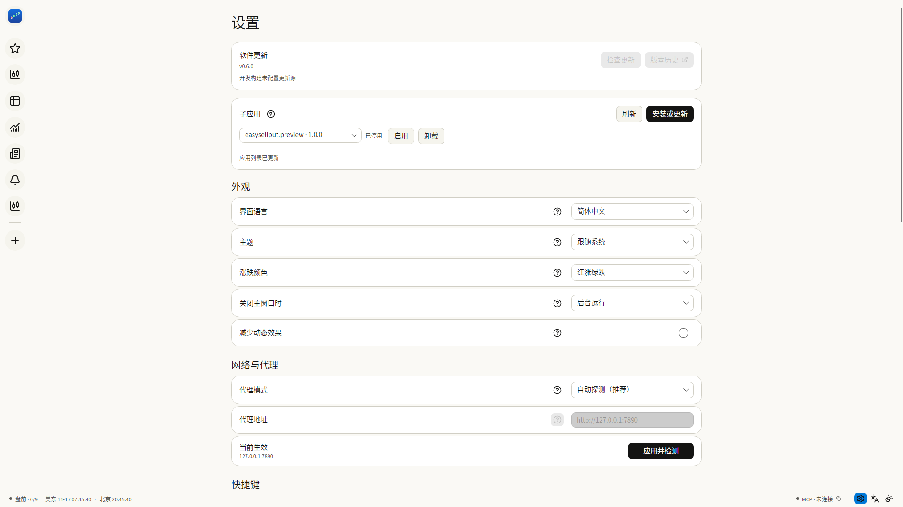
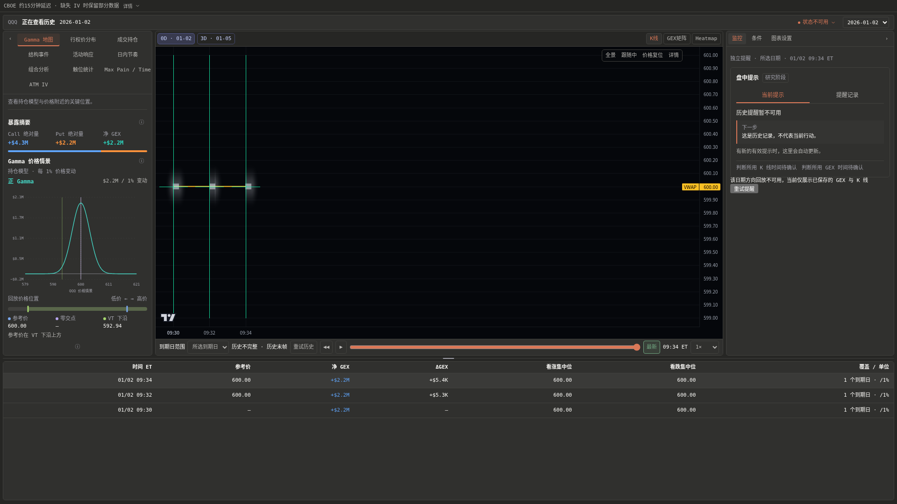

# Local application management

Settings → Applications installs or updates a local `.espapp` signed by the repository/key compiled into this host. Select an installed app to enable, disable or uninstall it. Close its active page/tasks first: maintenance does not interrupt a running financial calculation. Uninstall retains observations, preferences, data and immutable package backups; explicit reinstall is required to restore a removed compatibility seed. Core-only packages do not add an empty desktop entry.

Discovery and enable verification are asynchronous. The UI and CLI share ModuleInstaller; installation is never exposed as an MCP tool. Application code is first-party signed code, not a sandbox for untrusted extensions. Development builds with no compiled update repository do not accept externally supplied packages.

The screenshots below are actual 1920×1080 Avalonia/Skia **headless renders**, with a metadata-only preview row. They are not native macOS/Windows WebView acceptance or real signed distribution evidence. Both language/theme pairs and compact layout are exercised in `ApplicationPanelTests`; existing form-alignment checks remain intact. Windows has matching native tests in the full WPF suite.

Pending pilot acceptance, including remaining GEX facade ownership, final signed/native packages, is tracked explicitly in ../../TODO.md. This page describes current local maintenance behavior, not completion of S01–S12.

## Reusable application pages

Enabled signed UI modules can contribute a desktop rail entry. Both platforms use `PrivateAppSession` and a native `PrivateAppView` adapter. The private loopback origin serves only declared signed files and app-owned operations, with a random token, strict origin checks, bounded clients/requests and the shared dispatcher permission/schema rules. Remote article and personal website views have no access to it. Hidden pages release their native view and cancel requests; execution leases remain held until those requests finish cancellation.

`web/app-sdk/client.mjs` provides browser discovery/invocation without sockets or market polling. `tools/Meili.AppDev` is a separate source-development executable: temporary profiles, explicit development public key, read-only operation execution and private UI preview. It is never shipped in a production package and cannot select an existing data directory. See its README for the current original-GEX preview limitation.

## Shared presentation

`AppViewPresentation` projects the existing design tokens, language and reduced-motion setting. Signed private pages read `host/presentation` or use the browser SDK's cancellation-owned `presentationChanges(signal)` iterator. Updates wake pending requests; unchanged state does not trigger another redraw. There is no extra quote timer, remote connection or UI preference write endpoint. Hidden page disposal cancels pending waits and detaches theme/language/motion handlers.

The browser SDK's `applyTheme` is now reused by the original GEX adapter. It compares actual tokens before requesting chart resize, so ordinary quote/status events cannot repeatedly resize an unchanged chart. Original kernels and palette definitions are retained.

This is a computed fixture screenshot, not live-market or native WebView evidence. Chromium empty/computed journeys verify no remote requests or script errors, preserved document/history selection, expiry switching and live theme/reduced-motion updates.

The existing GEX page also exposes the same scoped `host/catalog`, `host/invoke` and read-only presentation contract when the desktop explicitly injects its shared dispatcher. Only authenticated operations belonging to GEX appear; it cannot proxy unrelated host tools. Its legacy chart endpoints and QuoteHub channels remain compatible while domain handlers move into the app package. Native app/profile mismatch and core-only UI startup are rejected before opening financial storage.
