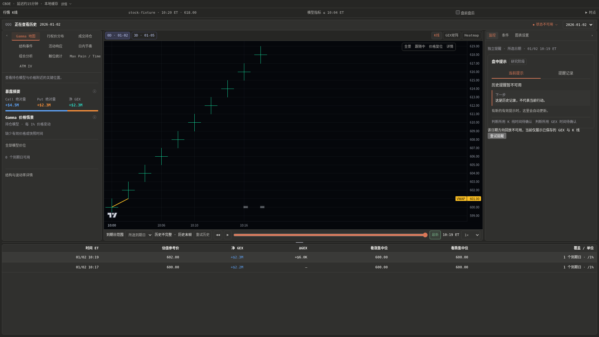
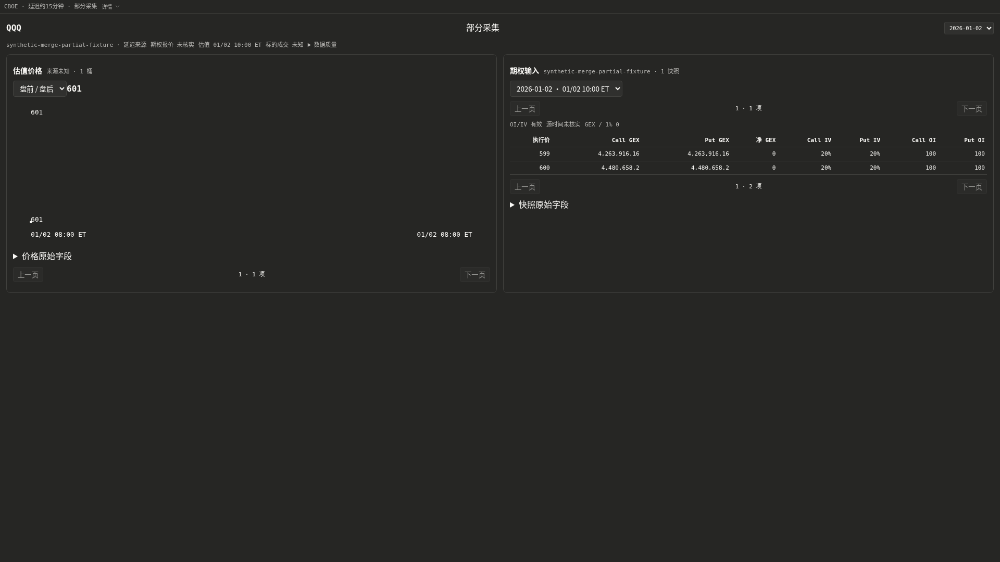

# GEX repair branch integration

Date: 2026-11-18 (Asia/Shanghai). Target: `work`, based on `25a2737`.

## Branch ancestry

The branches are stacked, not independent alternatives:

1. `gex/unified-partial-workspace-20261117` (`3550f1d`): partial observations, unified date navigation, paginated profiles and regular/extended retained prices.
2. `gex/price-clock-separation-20261117` (`d42cfed`): separate current stock-display observations from delayed option/model valuation inputs; explicit valuation-reference columns and archive `priceBasis`.
3. `gex/price-clock-ci-fix` (`5465c90`): includes both branches plus bounded MCP catalog-publication retry, current contract-surface guards and strict UTF-8 Node JSON decoding.

A merge of the third branch preserves all three histories. No branch is deleted or rewritten.

## Conflict resolutions

- Keep `work`'s UI-free `QqqGexAppSession` and thin native adapter. Port the incoming archive route to the shared document host so native pages and AppDev both receive it.
- Keep catalog fingerprints and discovery snapshots that include module issues, while retaining the incoming bounded, cancellable publication retry and deterministic fixture fault.
- Keep all completed S01–S12 records and append the GEX follow-up checklist.
- Use the incoming strict UTF-8 helper without losing the newer signed full-capture fixtures, profile isolation or fixed-host A/B tests.
- Retain app-owned public-contract guards; do not restore the obsolete inline-catalog lookup. Verify packaged operation schemas against facade metadata before packaging.
- Port both display-price capture and archive `priceBasis` into the signed Node handlers. Updating only legacy C# would leave installed applications on the old behavior.
- Exclude only receipt/poll clocks from display-input identity; retain changed prices, source times, valuation cutoffs and source identity. Raw first-observation bytes remain retained.

## Verification

Local verification: 1,053 .NET cases passed (Core 217, Data 160, Analytics 209, Shared 134, Avalonia 145, Automation 188; two Windows-only cases explicitly skipped on Linux), SDK nine, Python 60 and all 58 real CLI/MCP capabilities. The offline aggregate caught the integration gaps above; after correction, the complete signed GEX journey passed all nine capture fixtures plus source failure, existing eight facades, fixed-host A/B/new-operation, optional UI and uninstall/reinstall preservation. The new fixture uses a trading-day expiry; the original algorithm's holiday refusal was preserved, not bypassed.

The new delayed capture proves nine stock-display buckets versus one eligible valuation bucket through original C#, the signed app, CLI and MCP. Four HTTP route cases verify forwarding, explicit missingness and foreign-route rejection. Display-identity tests verify duplicate polling retains original bytes while changed price, source or model cutoff produces a new observation. Real Chromium/AppDev generic and original GEX journeys, the partial-workspace pagination/date-promotion journey, full styled partial document, independent price-clock browser and original UI/MCP kernel parity all passed. Original source verification retained 316 unchanged hashes and six reviewed presentation patches. Release-policy checks passed.

Exact-commit GitHub native/package CI will be recorded after the merge push; pending CI is not accepted as passed. New partial-workspace and price-clock browser journeys are included in normal GEX CI. Screenshots below are actual 1920×1080 Chromium renders of explicit synthetic historical inputs, not native screenshots or live-market evidence. The standalone component pagination harness is functional coverage, not product visual acceptance.

## Boundaries

The original financial kernels and their source hashes remain unchanged. Missing IV, incomplete sessions and uncertain option timestamps remain explicit. Stock observations still follow successful option capture; this merge adds no independent sampler during complete option-source failure and invents no historical data.

Existing installation signature, permission and exact-contract compatibility checks remain effective. A source merge neither publishes a new signed app nor replaces already installed payloads. Older installed packages with differing schemas remain subject to the existing compatibility refusal policy. Main-only release and explicit publication rules are unchanged.
