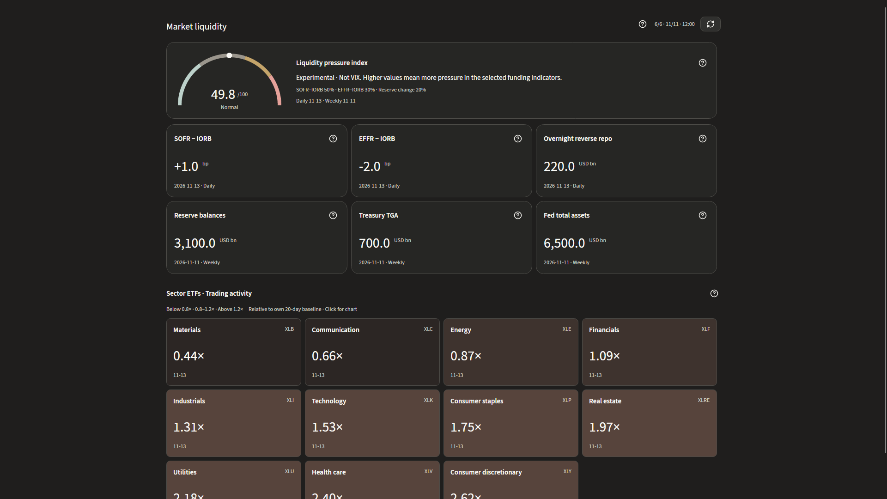

# S13 — Market liquidity migration

## S13a: compatibility core

The second app is `easysellput.market-liquidity`, versioned independently in `web/market-liquidity/app.json`. Its core-only package exports the existing read-only `get_market_liquidity` contract. Installed CLI/MCP discovery resolves its authenticated operation through the same registry, installer, runtime, job/asset leases and engine SDK as GEX. There is no second package manager, quote socket, provider router, data store or financial calculation implementation.

The first core is deliberately a compatibility adapter. It calls the existing bounded host MarketLiquidityService directly; that uses the existing FRED/ETF providers, managed caches, LiquidityProjection and Analytics math. There is no recursive public dispatch. The app does not fabricate dates, interpolate funding spreads, reclassify completed-day proxies as live flows, or fill unavailable pressure scores. The JSON report is passed through unchanged, including future-compatible optional values, provenance and explicit errors.

Only the explicitly owned built-in operation can be replaced. Permissions and schema must remain identical; a liquidity package cannot replace get_quotes or GEX tools, and another app cannot claim liquidity. Adding domain names does not grant arbitrary dispatcher access. Disabled/uninstalled apps disappear from CLI/MCP discovery and cannot resurrect their compatibility operation. Corrupt registry/app metadata is diagnosed rather than silently falling back to built-ins. Ordinary users without an installed or suppressed liquidity package retain the current built-in behavior.

## Build and checks

The existing `build/pack-app.py` now selects `--app market-liquidity`; both apps share the same manifest signing, hash table, platform/runtime pins and zip writer. The reusable SDK build tool uses the existing lock-pinned esbuild from the current toolchain; it bundles the SDK into the artifact, so execution has no dependency on the GEX app or node_modules. It does not compile the host.

`Apps · Build & Test` builds and packages both apps on Windows x64, macOS Intel/Apple Silicon and Linux x64, and executes the liquidity package's actual Node entrypoint against synthetic host replies. Its checks verify real ECDSA signature, complete signed file table, exact report/missingness, source-error propagation and invalid-argument rejection. These are fixture evidence, not live source completeness.

Application tests install signed liquidity A and B through the real installer/runtime, compare reports against actual shared fixture-backed MarketLiquidityService replies, and exercise disable/uninstall/reinstall plus foreign-operation/write escalation rejection. Existing complete capability cases already exercise `get_market_liquidity` through real CLI/MCP; no public operation or schema was added. GEX packaging is separately reverified after extracting the shared writer.

## Remaining acceptance boundaries

S13a+b alone do not establish complete S13 acceptance. Native liquidity now resolves the installed report through LiquidityAppClient, with the same existing MarketLiquidityService instance when host inputs are requested. Its signed execution/compatibility fallback respects disable/uninstall and corruption, propagates request cancellation and deserializes the existing report DTO. The view model retains its generation fencing, shared controls and refresh lifecycle. No UI styling or business algorithm changed. The shared release workflow now selects both app identities explicitly, resolves each manifest version, downloads its exact required-CI artifact and promotes it sequentially. One protected concurrency group also serializes catalog renewal. Catalog generations use max(run ID, authenticated previous generation + 1), allowing two versions in the same workflow run while preserving all other entries. Manual recovery selects one app. Real fixed-host CLI/persistent-MCP A/B, uninstall/reinstall and retained-data tests now pass; the native exact-commit gate is recorded in the final acceptance below. Production signing setup remains separate and incomplete; test keys are not installation trust overrides. No release or main merge is performed by this migration.

## Local evidence — S13a+b

1,060 .NET cases passed (two additional Windows-only skips), Python 75, SDK 9 and all 58 real CLI/MCP capability cases passed. Full-script maintenance tail and exact-commit native CI remain separately tracked. The actual signed liquidity engine and existing GEX archive smokes both passed. Images below are 1920×1080 Avalonia headless captures with synthetic provider data; they show existing native controls, not proof of installed production trust or live connectivity.

## S13c local delivery acceptance

`liquidity_mcp_smoke.py` installs the actual packaged A/B through the shared installer in a test-only trust host. It invokes the existing tool using real CLI processes and a persistent official SDK MCP process, checks unchanged schema/data semantics and a fixed host binary hash, then uninstalls using the real CLI manager. Discovery removes the tool, invocation fails, retained data survive, and reinstall restores it. The test host reuses the production catalog policy instead of maintaining its own disabled-domain filter. No production fixture switch was added.

Both real app archive re-signing/catalog/provenance/promotion tests pass with every GitHub write intercepted; wrong-app artifact substitution and stale catalog publication are rejected. Python policy suite now has 78 passing cases. Generic persistent MCP update modes and full GEX operation regressions are rerun after the shared catalog change. App-only four-platform build/test run [44239654589](https://github.com/two4i6/EasySellPut/actions/runs/44239654589) passed at unchanged core payload commit `02b470d`; final exact-revision evidence follows below.

## Final acceptance — 2026-11-18

S13 passed at implementation **86f59ed8d569432e470406ff391c1ef2ee7aabe0**:

- [Integrated CI 44240521185](https://github.com/two4i6/EasySellPut/actions/runs/44240521185): successful Required checks, Windows x64/Mac Intel/Mac Apple Silicon desktop packages and updater execution, four native CLI/MCP packages, UI, Web and release guard.
- [App CI 44240521145](https://github.com/two4i6/EasySellPut/actions/runs/44240521145): all four native app core jobs passed for the exact current payloads.
- Initial UI attempt stalled on an Ubuntu mirror downloading Noto CJK. UI-only rerun at the same SHA passed in attempt 2; all successful native results were retained. No code change, missing-font fallback or skipped assertions were used to obtain acceptance.

The accepted scope is a core-only independent liquidity compatibility adapter and the existing native report surface. Shared host financial kernels/providers remain deliberately shared. The liquidity UI is still the native reusable host UI, not an independently packaged Web UI. This proves the second app can reuse the installer/runtime/catalog/controls and keep CLI/MCP contracts while updating its core; it does not certify complete live coverage, new financial methodology or a publicly installable production release. Production signing/bootstrap and main release remain separate. This documentation-only acceptance commit cites the tested implementation; pending CI for later documentation must not be represented as already passed.
