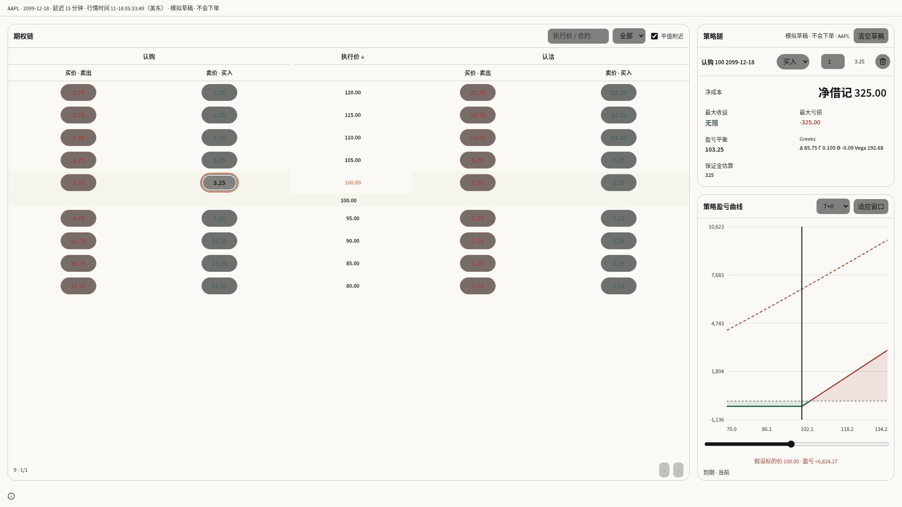

# S15 — Options and strategy

## Boundary

`easysellput.options-strategy` contributes twelve existing operations as one signed core. Generic calculate_option/calculate_indicators remain host-owned so registry recovery cannot disable general calculators. Shared Analytics, provider routing, full native chain receipts, quotes, private workbench rendering, transient drafts and original strategies.json/IV/OI history stay host-owned. Native full-chain loads deliberately retain complete provider snapshots rather than invoking a paginated engine for each 500 contracts or spawning a process per slider move. They hold verified domain execution leases through native processing. Save/delete use the authenticated app operation; source receipts are not new public DTO contracts.

## Write authority

Only the exact first-party save_strategy/delete_strategy/record_option_snapshot may declare its corresponding host write. Read sessions cannot grant writes. An explicitly authorized writer gets at most one host mutation with the original operation and arguments; altered arguments, another mutation, repeated calls and success without a successful host call fail. CLI and MCP use the same production dispatcher implementation; fixture hosts inject only test package verification/runtime dependencies. Desktop save/delete are async, preserve drafts on failure and retain name edits made while pending. StrategyStore applies its in-memory change only after the optimistic atomic file write succeeds. Uninstall retains original data and suppresses compatibility resurrection.

## Delivery and acceptance

Fourth-app packaging and sequential main-only catalog promotion reuse the shared SDK, writer, signing/provenance flow and protected release job. Required CI includes its artifact, signed engine framing, intercepted release promotion and fixed-host A/B CLI/persistent-MCP cases on all four CLI platforms. Main-only publication and the independent release switches are unchanged. No release is published from work.

Accepted code: `65a2336050b5ca6128fff00dea160ddf22bdfb15`. [Integrated CI 44297121634](https://github.com/two4i6/EasySellPut/actions/runs/44297121634) passed all eleven checks on its first attempt: Windows x64, Mac Intel and Apple Silicon desktop packages/WebViews/updaters; four CLI/MCP platforms; layout/charts; GEX Web; main-only policy and aggregate gate. The concurrent market-glance tooltip feature (`a93b436`) is preserved and included in this tested revision.

| Evidence | Outcome |
| --- | --- |
| [Four-platform app core CI 44286770898](https://github.com/two4i6/EasySellPut/actions/runs/44286770898), `28720ac` | All four platforms passed; options engine/package sources are unchanged in accepted code |
| Local `bash build/test-headless.sh`, UI/core checkpoint before the concurrent tooltip merge | 1,079 .NET tests passed; two Windows-only Core tests skipped on Linux; 80 Python policy tests, all 58 CLI/MCP operations, signed A/B apps and maintenance/data preservation passed |
| Final combined local Mac/Shared suites, Release | 150 / 146 passed, zero failures |
| Real Chromium ↔ C# workbench journeys | Three passed, including paired quote toggling, entry premiums, payoff, locale/theme and narrow layout |
| Intercepted fourth-app release smoke | Real re-signing, provenance/catalog promotion, stale-generation rejection and private-key cleanup passed; all GitHub writes intercepted |
| Windows UI cross-build | Passed; actual native execution is proven by accepted CI, not the cross-build |

Verification exposed and fixed a three-app catalog expectation, missing clean-runner options engine build, and native popover tests that still searched the page tree. Full UI testing then identified the inactive-grid selection feedback fixed below. Earlier runs also encountered pre-existing Windows lock/immediate-exit fixture timing races and one local shortcut-navigation timing failure; these are not claimed fixed by S15. Final combined local suites and all accepted-code CI checks passed. Font-mirror stalls in earlier runs required fresh runners; no fonts, tests, architectures or checks were removed. Existing bitmap API and test-nullability warnings do not prevent builds; zero warnings is not claimed.

S15 is complete. No main merge, public release or independently delivered options Web UI is implied.

## UI and interaction

Reference: https://www.wealthsimple.com/en-ca/trade/options (retrieved 2026-11-18; intuitive trading, streaming quotes, workflows and advanced strategies), together with the user-provided screenshot. Reuse our Claude tokens, Lucide aliases, popovers and shared Web components; this remains simulation, without brokerage orders, fees or account balances.

- Workbench: centered strikes, Call/Put on either side, observed Bid/Sell and Ask/Buy chips. A second click removes the matching draft leg. Missing/crossed quotes cannot create legs; C# resolves source prices, not HTML input. Refresh and quantity edits preserve entry prices.
- Right ticket: compact legs, side/quantity/remove controls, prominent net cost, maximum profit/loss and breakevens. Existing Greeks, margin and source/model details remain available. Payoff shading uses the existing C# samples and configured gain/loss colors.
- Native pages: refresh/export/saved controls use consistent icon buttons. Four leg actions share one popover. New profiles default to compact option columns; an explicitly stored expanded preference remains unchanged. Strategy presets and quantity controls retain accessible names without redundant labels.
- Mac option grids release row/selection bindings when detached and rebind when attached. Closed or hidden grids cannot coerce the active shared selection to null. The native journey closes an old window, selects a visible contract, checks all four actions, leaves and returns.
- Workbench help and model notes are progressively disclosed. Data failures, missing quotes and coverage limits remain visible. Small control transitions respect reduced motion; market values, charts and split resizing are not animated.
- Desktop keeps native and private WebView presentation. This is a core-only independent package, not an independently delivered options Web UI. The paginated public chain and full native provider snapshot are intentionally different contracts.

## Screenshots and test scope

The following are 1920×1080 real Chromium renders backed by the C# workbench fixture host. Prices, expiry and source are fixtures, not live market evidence. Native headless tests separately cover toolbars, alignment, locale/theme and narrow layouts; their WebView placeholder does not prove native browser rendering. Native CI remains required.

Browser journeys cover quote selection/toggling, locked entry prices, quantity/side/removal, recomputation, filters, payoff zoom/pan/fit, what-if, help, theme/locale and 480px layout. Shared regressions cover corrupt-registry navigation, compact preference persistence and failed atomic-save memory state. Signed process tests cover all twelve original operations, explicit write authority, read-only MCP, A/B update/rollback and retained user data.
