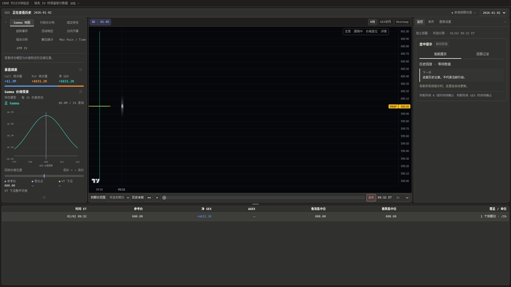
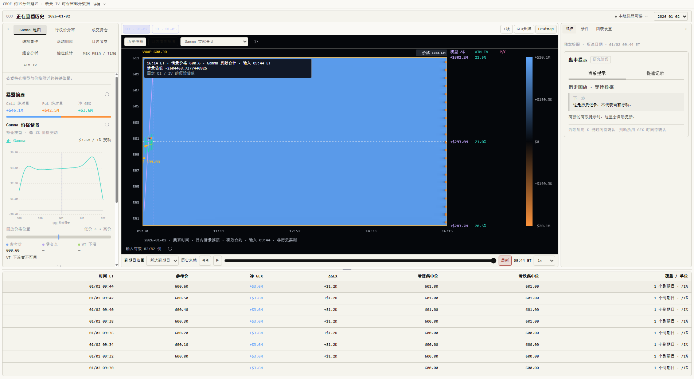
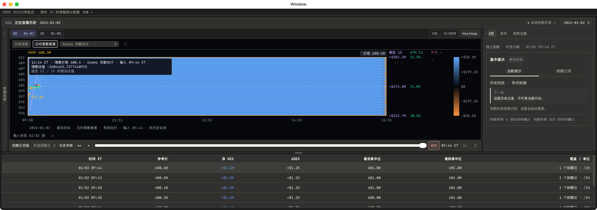

# GEX independent-app pilot acceptance

Status: S01–S12 accepted on 2026-11-17. Implementation revision `3b476cc`; final acceptance changes are documentation-only.

## Delivery boundary

The runtime/CLI/MCP/desktop changes land on `work`. Users need one host version containing the signed app runtime; subsequent compatible GEX payload updates do not require rebuilding/reinstalling that host. No main merge or public release is part of this acceptance. Source/development-key artifacts do not become trusted product installers.

## Ownership and reuse

| Owner | Responsibility |
| --- | --- |
| Host runtime | Repository/key trust, package verification, atomic profile registry, leases/jobs, pinned Node, typed provider/math capabilities, CLI/MCP dispatch, private AppView transport and native adapters |
| GEX package | Public GEX contracts, capture orchestration, original model bundles, views/archive/lifecycle/live-decision projections and optional original UI |
| Shared SDK/design | Bounded framing/receipts/uploads, browser invocation/presentation, canonical generated tokens and existing native UI primitives |
| Compatibility layer | Existing public C# entry points and unregistered-profile seed; uninstall suppresses fallback and never deletes retained history |

The SDK is in [web/app-sdk](../../web/app-sdk/README.md); source-only preview is in [tools/Meili.AppDev](../../tools/Meili.AppDev/README.md). Generic and GEX documents share request parsing/scope, presentation and request-draining shutdown. There is one desktop QuoteHub; the SDK creates no page-specific market socket or timer. CLI/MCP remain UI-free.

## Functional acceptance

| Step | Result and evidence |
| --- | --- |
| S01 | Baseline recorded in TODO; original capabilities, permissions and native failures distinguished from infrastructure |
| S02 | One asynchronous profile catalog/dispatcher for CLI/MCP/private views; discovery is metadata-only and non-mutating |
| S03 | Authenticated core/UI packages; exact manifests/file hashes; unsafe paths/links/duplicates/source/protocol/data identities rejected |
| S04 | Immutable hash-addressed packages, process-identity execution leases, CAS/journal recovery and request-generation binding |
| S05 | Local install/update/disable/uninstall/recover; corruption isolation/exact repair; data-format retention; no MCP maintenance capability |
| S06 | Original GEX bundles/source notices packaged independently; A/core→A/UI→B/UI works with fixed host files and pinned runtime |
| S07 | Eight original GEX facades app-owned; capture source timing, missingness, raw hashes, partial/full archives and errors preserve original semantics |
| S08 | Persistent real MCP across A/B: both 2025 revisions and 2026 with/without opt-in subscriptions; read-only filtering, cancellation/EOF and CLI parity |
| S09 | Shared management/navigation/native AppView; original GEX in real native engines; locale/theme/compact/wide/input/lifecycle screenshots |
| S10 | Bounded queues/CPU/provider work, independent-app progress, same-app writer exclusion with committed readers, cancellation and scratch-only full original UI preview |
| S11 | Five-platform app-only core/UI artifacts without host build; main-only promotion of tested bytes; separate signed app feed, draft and explicit publication |
| S12 | Same-process native and persistent CLI/MCP A/B/new-operation journeys, unchanged host/history hashes, uninstall/reinstall and original-model parity |

## Reproduction and results

Code revision: `3b476cc`. Full offline aggregate `bash build/test-headless.sh` passed at `build/out/tests/run-BOmYIlNo`: 1,047 .NET tests (Core 217, Data 159, Analytics 209, Shared 134, Avalonia 145, Automation 183), with two Windows-specific cases explicitly skipped locally and executed natively in Windows CI. The same aggregate passed 57 Python guards, nine SDK tests and all 58 real CLI/MCP capability cases. It also passed actual signed original GEX A/B and eight capture scenarios plus source failure; source AppDev isolation; cache/IV/OI/user-data preservation; persistent MCP protocols; cross-process jobs/maintenance/owner EOF.

Windows x64 Core executed all 219 cases, including both real sharing cases. Its CLI and extracted desktop package cold-writer tests passed. One pre-existing symlink-permission test is skipped on Windows and executed locally on Linux.

Both actual Chromium source-host journeys passed at `3b476cc`. Original GEX was imported from explicit synthetic normalized input into a disposable profile; 1920/1280×1080 captures were inspected. These are browser/synthetic evidence, not native/live-market evidence. The original financial model was retained; absent historical coverage/decision inputs remain unavailable.

Independent package verification and real ECDSA re-signing/catalog/provenance/draft→non-Latest publication/stale-generation rejection passed offline. Every GitHub write in that release smoke was intercepted; no real release workflow was dispatched.

Independent app CI: [44140353533](https://github.com/two4i6/EasySellPut/actions/runs/44140353533) passed all five native platforms, both core-only and optional UI packages. App payload/SDK and app CI/release scripts are unchanged since that tested revision.

Integrated native/CLI CI: [44154390154](https://github.com/two4i6/EasySellPut/actions/runs/44154390154) **passed**, including `CI · Required checks`, all four desktop and five CLI targets, Web, UI and main-only release policy. This is the exact implementation revision `3b476cc`, using the existing supported `macos_arm_runner=macos-15` input. Default [macOS 26 run 44153618740](https://github.com/two4i6/EasySellPut/actions/runs/44153618740) could not acquire ARM64 runners; the fallback also required infrastructure-only retries before all native tasks actually executed. Earlier cancelled capacity jobs are not counted as passes. No platform, test assertion or release rule was removed. Final documentation-only commits cite this unchanged-code result; any newly triggered CI is a separate run, not claimed passed in advance.

## Windows publication regression

Final cold-profile tests exposed a real `File.Replace` failure on Windows, HRESULT `0x80070497` / ERROR_UNABLE_TO_REMOVE_REPLACED. This was diagnosed from bounded profile-scoped error stacks in both CLI and extracted desktop packages, rather than inferred from generic protocol errors. [Microsoft documents](https://learn.microsoft.com/en-us/windows/win32/api/winbase/nf-winbase-replacefilew) that error 1175 leaves both names intact. The existing bounded write lease now retries this exact error only after checking both destination revision and staged content. It does not retry a business operation or treat unsafe errors 1176/1177 as recoverable. Injected real-file regressions cover transient recovery, external writes, staged tampering and unsafe partial replacement; mandatory native process tests create three fresh writable MCP profiles and verify cross-process mutations and EOF persistence. Earlier failed runs remain recorded in TODO; they are not acceptance evidence.

## Screenshots

The [management and native evidence gallery](application-manager.md) identifies the renderer and actual dimensions of every image. Source Chromium previews are 1920/1280×1080. Native WebView2/WKWebView captures use installed test-signed payloads and preserve original charts, historical selections and missing-input states; platform work areas constrain native window heights.

## Operational workflow

1. Develop and test app code using the shared SDK and disposable AppDev profile. Reuse original model/data owners; never introduce a production development-key/profile switch.
2. Increment `web/qqq-gex/app.json` for changed payloads. Keep an old public operation when introducing a versioned replacement; incompatible schema/permission changes cannot replace it silently.
3. Let app-only and host integration CI pass. Main-only Apps release reuses the tested bytes, binds repository/key/hash/compatibility and prepares a signed draft; publication is a separate explicit action.
4. On an installed compatible host, use Settings → Applications or CLI `apps check/download/update`. Close the active app page/job before activation; idle MCP clients can remain connected.
5. Default uninstall retains financial observations, preferences/backups and data-format ownership. Reinstall compatible authenticated packages to reuse them. Unsupported migrations/downgrades are refused; retained observations are never rolled back as part of code recovery.

See [delivery](app-distribution.md), [package contract](package-v1.md), [UI and captures](application-manager.md) and [engineering rules](../../AGENTS.md).

## Limits

Synthetic/offline tests establish protocol, ownership, original-model parity and preservation; they do not certify live provider uptime or complete real-market coverage. Current signatures in test artifacts are development/ad-hoc, not trusted distribution signatures. Secret-backed release signing/notarization and explicit publication remain in the protected main-only release flow and were not executed for this `work` migration. Other business pages remain future migrations (S13 onward).
