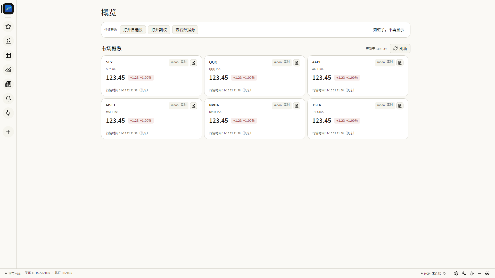
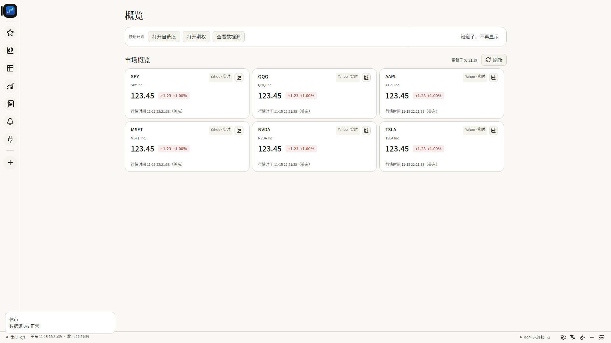
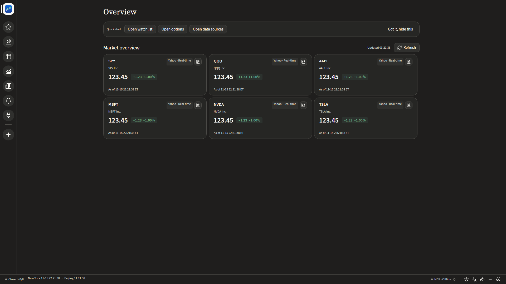

# Compact market and source status

The separate market-session label and source-health label are combined into one entry: `休市 · 0/8` / `Closed · 0/8`. The fraction is the number of healthy data sources over registered sources, not an exchange-open indicator. The dot reflects source health; unknown remains neutral and degraded/down sources use the warning color.

Hover/focus shows the full session, source-health summary and configured network description. Clicking uses the existing accessible `AppHelp` popup, with Escape/focus handling and existing motion. No new navigation, polling, network checks or CLI/MCP operation is introduced. Clock, MCP, updates and footer utilities remain separate.

Both WPF and Avalonia reuse the same `ShellViewModel` presentation properties. Existing hidden-window timer suspension and restoration refresh are preserved. The existing full Shared/Mac/Windows CI suites discover the new shared-state and native UI regressions automatically; no new job or test allowlist is needed.

## Full HD previews

These are actual 1920×1080 Skia renders with test data, not live quotes or screenshots of an OS-native title bar. Images retain original resolution; no upscaling. Dimensions and hashes are in [screenshots.json](screenshots.json).

